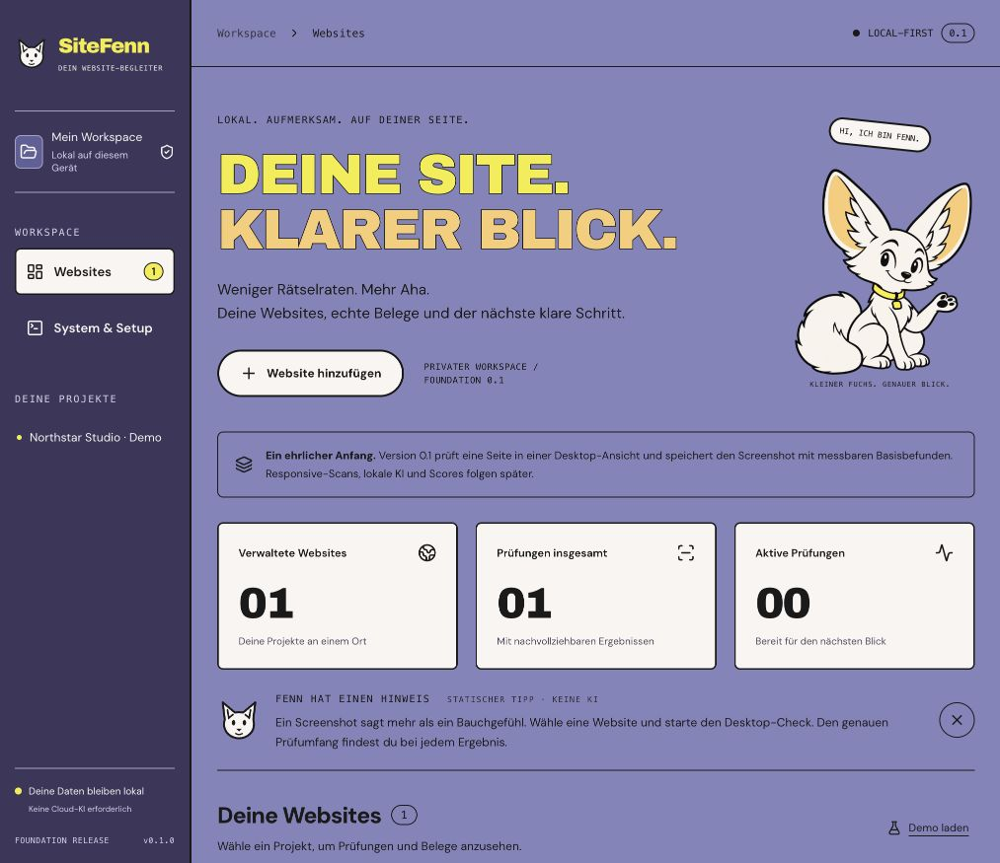

# Changelog

This file describes shipped scope, not the entire product roadmap. Version plans and release dates must not be presented as completed features.

## Branding update — before 0.2

- Introduced the SiteFenn display identity and Fenn mascot in the existing 0.1 application.
- Rebuilt the UI around a violet/cream, flat cartoon and editorial type direction, following the user's style reference.
- Added an original transparent mascot illustration, SVG signet/favicon, local Archivo Black/DM Sans fonts and their licenses.
- Added collapsible static guidance, clearly distinguished from future AI analysis and speech.
- Updated the brand guide and actual desktop/mobile screenshots.
- Preserved the existing repository/package name, data paths and stored projects. No crawler, LLM inference, speech, score or other 0.2 feature is implied by this update.

## 0.1.0 — Foundation

### Added

- Local React dashboard for saving and listing website projects.
- Durable SQLite storage for projects, scan state, and findings.
- Single-page desktop browser scan using Playwright and Chromium.
- Screenshot evidence and basic checks for page title, meta description, and H1 headings.
- Restart handling that marks unfinished scans as interrupted.
- Optional read-only local Ollama availability check.
- Local development/build workflow, automated checks, and architecture/security documentation.

### Scope and limitations

This is a trusted-owned-sites-only foundation. Responsive crawling, live browser streaming, complete SEO/accessibility/performance audits, scores, scan comparisons, local AI analysis, and Google integrations are future work. Browser/network isolation for arbitrary untrusted sites is not complete.

### Data

Application data is stored outside the checkout by default. No cloud account or model download is required for the basic scan. Stop the application before copying the full data directory for a manual backup.
