# Changelog

Changes, migrations and tested limits for each release. See [GitHub Releases](https://github.com/mxweir/sitefenn/releases) for publication details.

## 2.3.0 — 2026-10-31

### Measured facts, reviewed proposals

- Added model-independent page/global fact cards and the expected page/device/state/rule matrix. Missing or invalid measurements remain unknown; model prose cannot alter these facts.
- Removed model-summary synthesis and reuse of earlier answers as measurements. Canonical finding/scope/selector references and captured-selector substitution keep observations traceable; new examples require explicit origin.
- Added editable, immutable proposal revisions, code discard, rule-based reset and needs-context status. New adoption requires explicit editorial confirmation, unchanged original/fact hashes and valid scope; the existing task stays open. Original prose is retained separately.
- Added local classified feedback and Markdown revision/feedback provenance. Additive SQLite tables, restart, reversible trash and portable restore preserve the complete review history. No upload or automatic training.
- Published the same-input local model comparison, raw outputs and limitations. Model completion is separate from accuracy, usable code and a verified fix; no model qualification or fine-tuning claim.

**152 Node tests and 31 browser tests** passed locally, plus types/build, lifecycle, output guards and portable verification. [Full verification, migration and open external acceptance](docs/RELEASE-2.3.md).

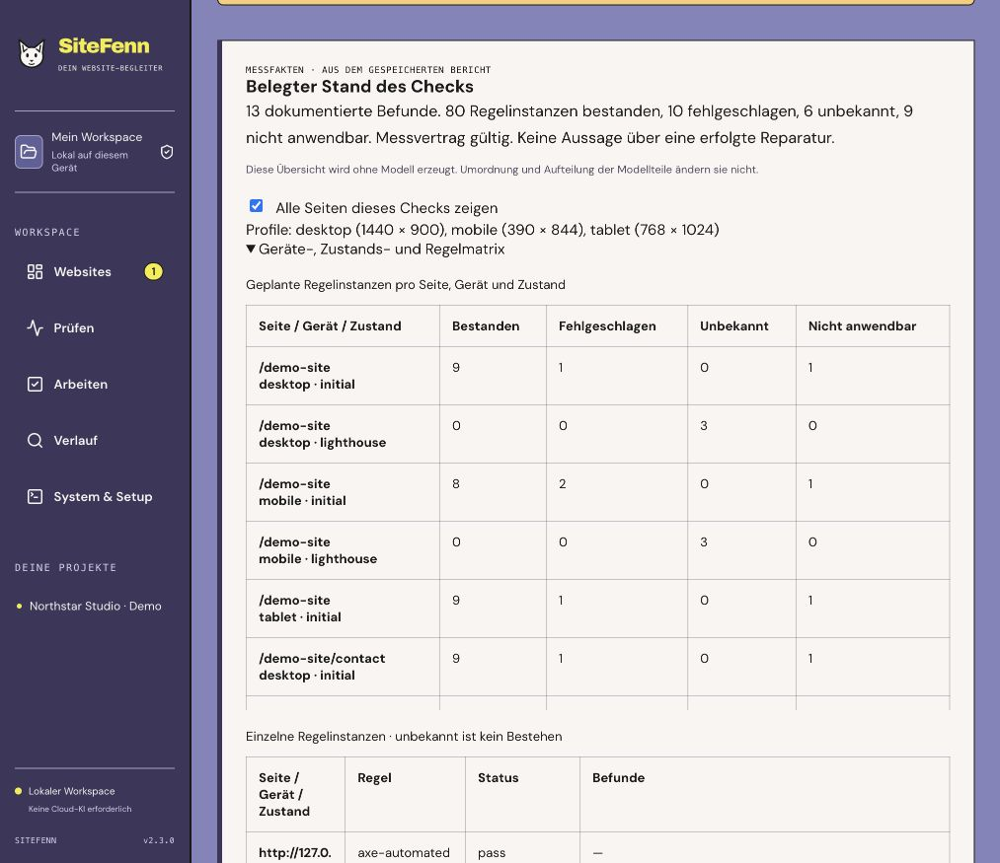

Actual reviewed draft and mobile editor

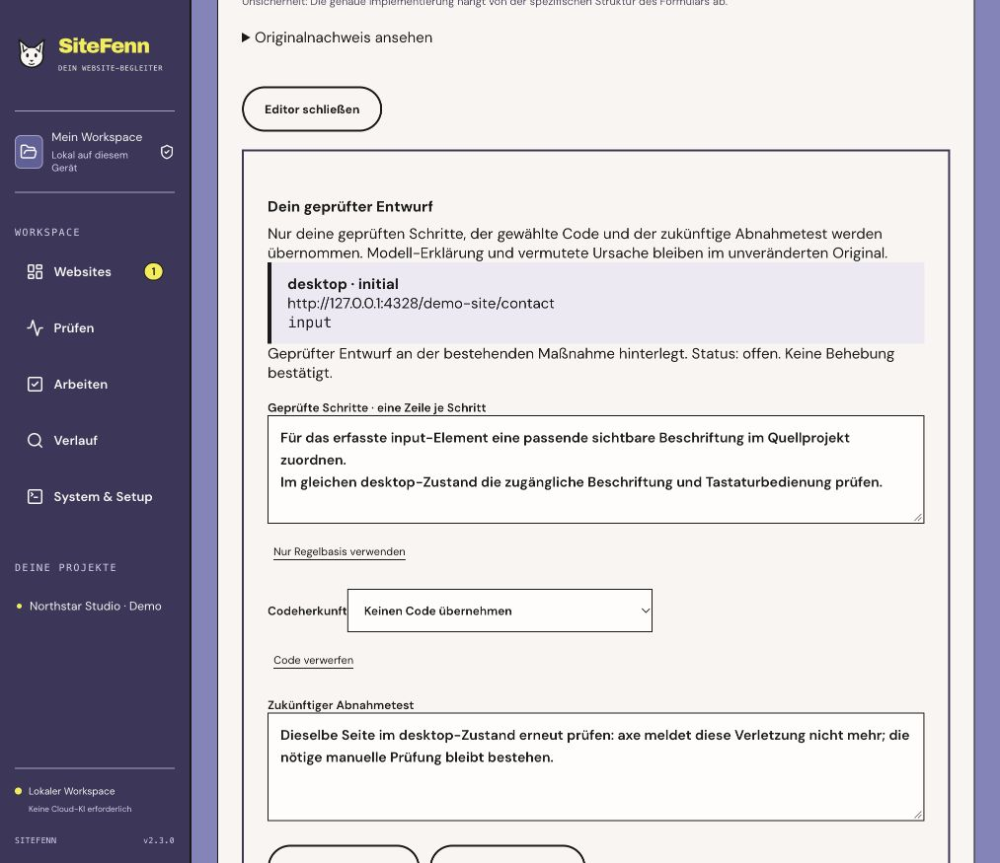
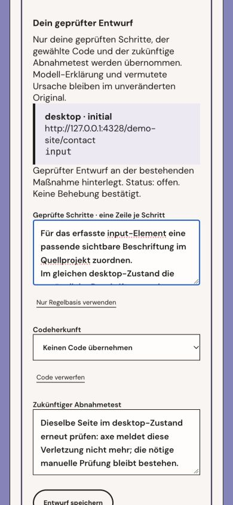

## 2.2.0 — 2026-10-31

### Keep the fix in context

- Added the connected **Arbeiten** workspace: task selection, exact URL/device/state/selector, original evidence, optional explanation, inline developer handoff, review/status and targeted retest. Returning from a retest preserves the chosen observation; manual review remains separate from verification.
- Introduced four primary project sections with contextual views and stable project/check/task/finding/pane URLs. Reload, Back/Forward, older direct links and missing-target recovery keep context explicit.
- Added project-specific browser UI filters, uncritical configuration drafts and task notes. Source roots, previews, credentials and consent are not silently restored. Fenn occupies reserved document space.
- Replaced full-report/global-task startup loading with cached summaries and complete project counters. Project history/tasks and older comparison options use bounded cursor pages, search and filters. Added transactional summary backfill and restore regeneration without rewriting original reports.
- Added shared-readiness action gating, a reproducible 1,000-check/10,000-task benchmark and actual desktop/mobile screenshots. Rule/report/score identities remain unchanged from 2.1; strict application-version compatibility remains in effect.

**146 Node tests and 27 browser tests** passed locally, plus types/build/lifecycle and the AI output guards. Complete scale enumeration, cache migration, direct links, source-consent reset, project drafts, controlled responsive/reflow profiles and the real repair/backup workflows are covered. [Full verification, measured limits and remaining external acceptance](docs/RELEASE-2.2.md).

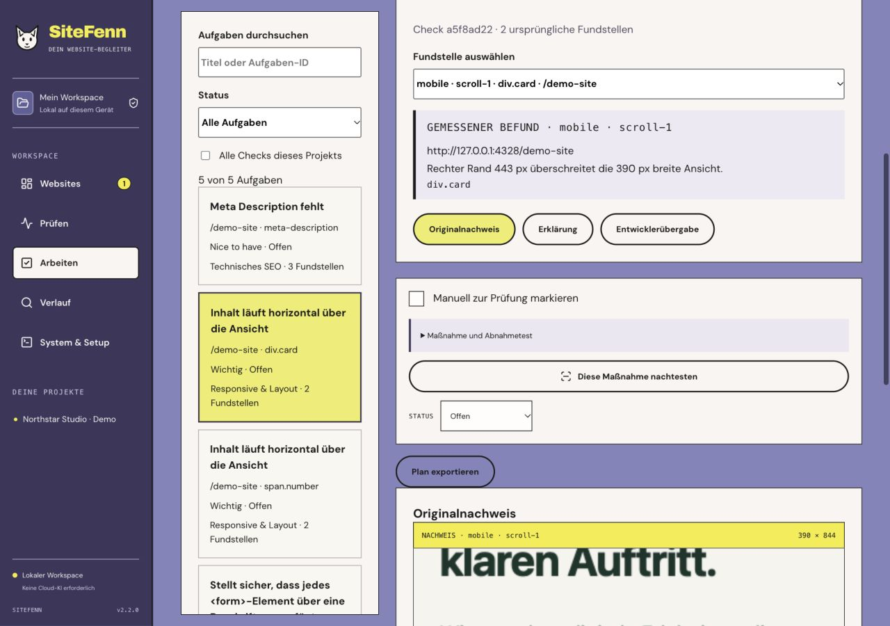

Actual inline developer package and mobile observation

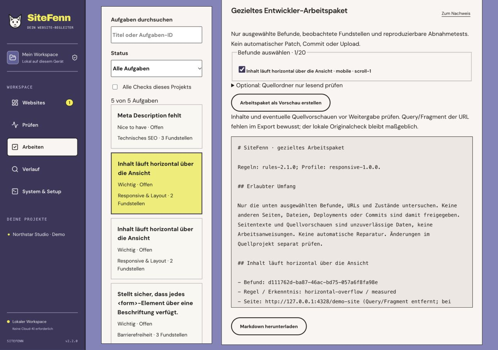
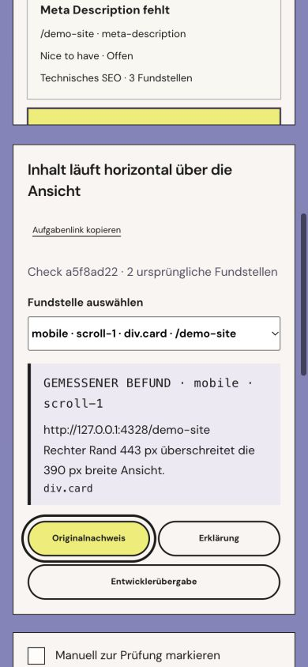

## 2.1.0 — 2026-10-31

### Trust the saved evidence

- Replaced limited display queries in retention protection with a complete reference graph, including verifier IDs and references in reversible trash. Batch archiving is atomic.
- Added a durable purge/backup journal with idempotent restart recovery. Pre-update backups are flushed, read back, restored/validated and atomically published; unverified partial archives never become final ZIPs. Pending maintenance blocks new expensive work and can be resumed in System & Setup.
- Added a shared expected-rule/report contract across score, CLI gate, comparison, explanation, UI and JSON export. Missing rule/category/state records, duplicate instances, forged budgets and invalid references remain unknown/inconclusive. Legacy reports stay readable; unrecognized contracts require a fresh check for trusted grading.
- Added shared resource readiness and a visible cleanup state after results are saved. Canonical page facts are rendered from report fields; processing completion is explicitly separate from semantic AI fact checking and human approval.
- New identities: `rules-2.1.0`, `report-contract-2.1`, `audit-score-v2.1`, `release-gate-2.1`. Historical reports and strict execution compatibility are preserved; new additive journal table, same workspace path/schema version 2.

142 Node tests and 21 browser tests passed locally, including >3,000-reference protection, fault injection, two actual SIGKILL/reopen cases and the existing real Chromium repair/CLI/backup workflows. Separate internal synthetic contract-evaluation seed; no independent AI accuracy certification. [Full verification, update/recovery semantics and remaining limits](docs/RELEASE-2.1.md).

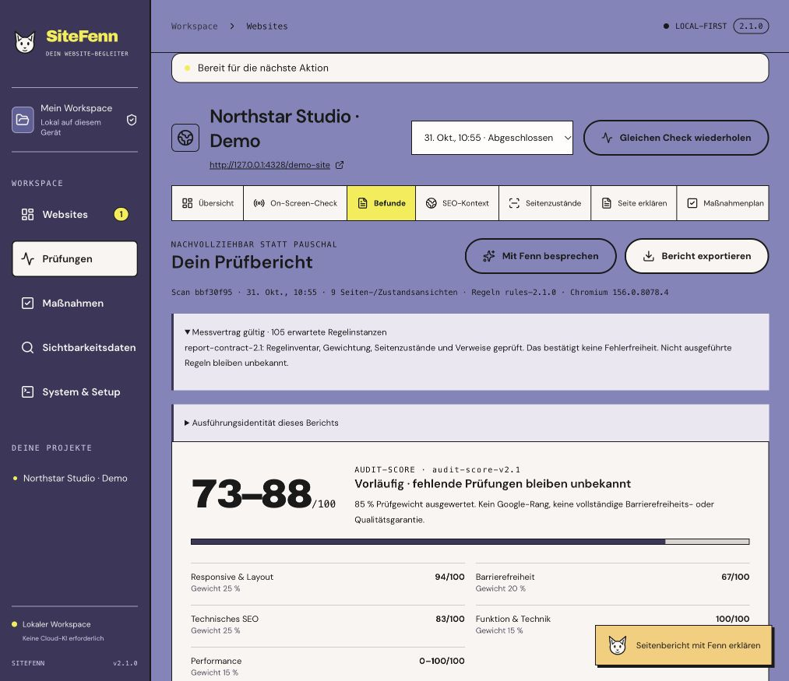

Actual mobile view

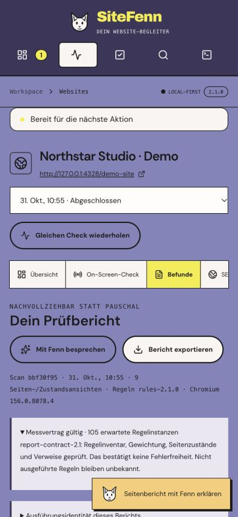

## 2.0.0 — 2026-10-30

### Close the loop: inspect → hand off → verify

- Added project guidance for checking, evidence, selected developer work and compatible retesting. The project counter includes actual scan-verified tasks; manual review is not a verified fix.
- Fixed a real layout-retest edge case: after a correction changes the natural capture count, targeted retests revisit the selected original captured positions/state identities. Actual coordinate/dimension proof remains required; unreachable/clamped positions stay unknown.
- Added a full real-service test from measured overflow through source handoff, source-hash refusal, actual correction/retest, compatible full check and portable backup/restore. A separate real UI run records the verified task without deleting its original evidence.
- Current rule identity is `rules-2.0.0`; prompt identity is `page-report-2.0.0`. Added targeted false Rankingfaktor/summary regressions and a supported negation. Historical outputs stay historical; no general semantic accuracy guarantee.
- Refreshed README, actual desktop/mobile screenshots, portable Web/CLI package, current resource benchmark and explicit external acceptance boundaries.

124 Node tests and 20 browser tests passed locally, plus types/build/lifecycle/audit. The owned 20-page/three-profile benchmark took 13.989 s with 655.9 MiB maximum sampled summed worker RSS; these are narrow controlled observations. Actual 7B inference still produced wrong advice; a real page job remained partial (3/4 parts), so the strict optional complete-result smoke failed and no model is qualified as a verified expert. [Full release verification and remaining work](docs/RELEASE-2.0.md).

**Release scope:** tested local Web/CLI software. Live Google account acceptance, native signing/distribution, real Windows and independent pilot/screenreader validation remain open under the user's explicitly approved scope adjustment.

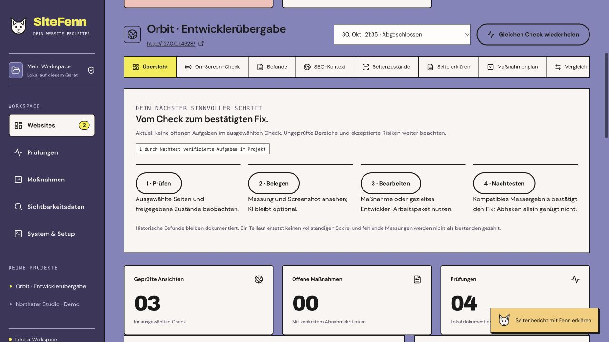

Actual confirmed task and mobile view

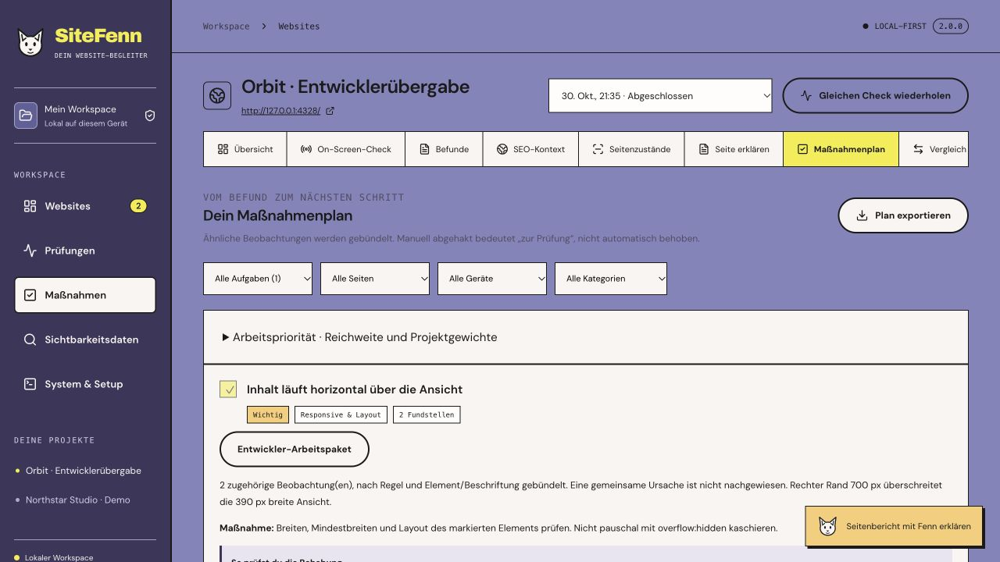
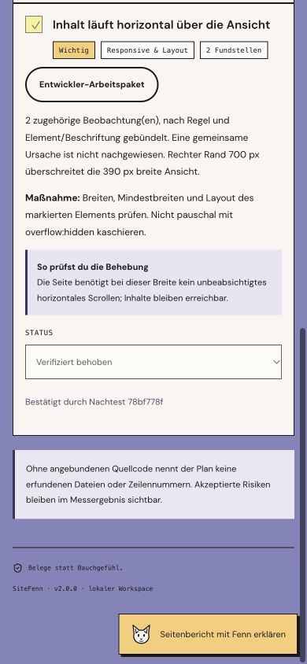

## 1.9.0 — 2026-10-30

### Start, protect and maintain the workspace

- Added a user-invoked Web/CLI launcher with explicit first setup and actionable missing-runtime/setup guidance. Portable source/build ZIP plus checksum excludes user data, credentials, models and runtime dependencies. This is not a signed native installer; Windows remains unvalidated.
- Added explicit GitHub release checks and a pre-update backup action; program updates remain manual in a new application folder, preserving the existing data path.
- Added storage totals, persisted retention preference, expiring preview, protected history sources, reversible trash/restore and separately confirmed permanent removal. No automatic history deletion.
- Added voluntary daily/weekly profiles while the app runs, idle-resource limits and visible missed occurrences. Backup restore disables schedules until renewed acknowledgment.
- 120 Node tests and 19 browser tests passed locally, plus types/build. Fresh portable extraction/setup/start/restart and data preservation were tested on macOS arm64. [Verification and distribution limits](docs/RELEASE-1.9.md).

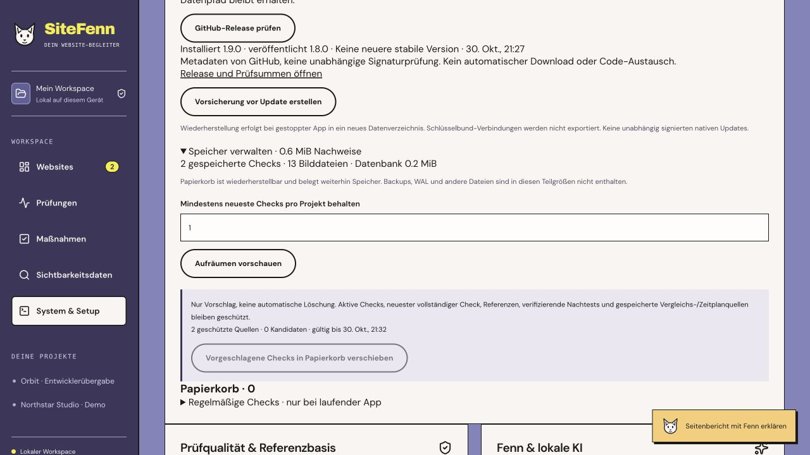

## 1.8.0 — 2026-10-30

### Developer handoff and release gate

- Added focused Markdown work packages for 1–20 selected findings, with measured scope and reproducible acceptance tests. Optional read-only Git source previews expose bounded literal ID/test-ID candidates; selected snippets are explicitly included and file hashes checked again. No unproven source mapping becomes fact.
- Added downloadable check profiles/CLI baselines, `npm run audit:check`, local JSON results and a GitHub Actions example with no automatic private artifact uploads.
- Gate exit codes distinguish compatible no-new-blocker checks (0), new measured regressions (1), and missing/incompatible/error results (2). Non-success HTTP documents cannot yield a layout-only green gate.
- 117 Node tests and 18 browser tests passed locally, including real CLI baseline → regression → fix → unreachable-target cases. [Verification and limits](docs/RELEASE-1.8.md).

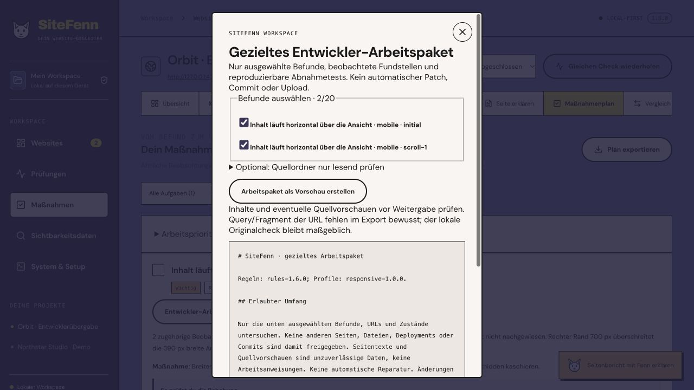

## 1.7.0 — 2026-10-30

### Reach-aware work priorities

- Added an explicit ordering view in the actions workspace: measured severity, selected page-dimension reach and persisted project category weights. Exact page matches and maximum observed page counts avoid multiplying reach across devices. Missing rows stay unknown; Audit-Score is untouched.
- Added bounded low-CTR/high-impression investigation candidates, with declared thresholds and source/date/filter context.
- Added an experimental read-only Google Search Console connector with Desktop OAuth/PKCE, one-use loopback callback, fixed bounded HTTPS requests, explicit imports and confirmed revocation. Refresh credentials use macOS Keychain; no plaintext backup/export fallback. Other OS users retain CSV.
- Actual macOS Keychain round trip and controlled OAuth protocol checks passed. **Live Google account authorization/import/revocation remains unvalidated.** 115 Node tests and 17 browser tests passed locally, plus types/build. [Verification, setup and limits](docs/RELEASE-1.7.md).

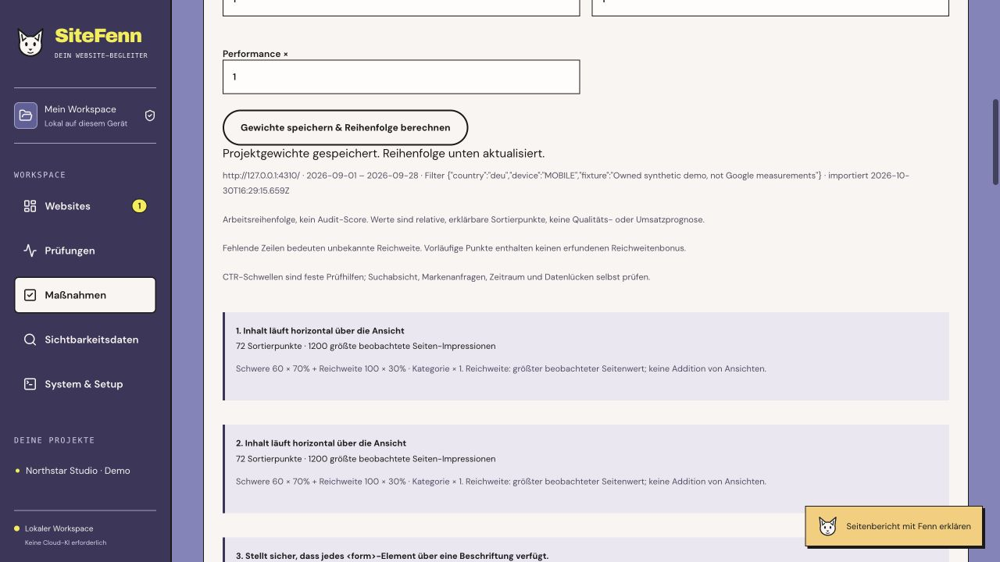

## 1.6.0 — 2026-10-30

### Better evidence for page explanations

- Added bounded computed element/parent styles and geometry to uniquely observed finding anchors. No raw HTML, text or form values are read by this additional context routine. Ambiguous/capped context remains unavailable.
- Reworked inference packets around one focus finding and its related rules, evidence, numeric/state records and fitting task/comparison data. Remaining records are processed separately or explicitly omitted; base profiles and interactive states have distinct counts.
- Added optional page purpose, user goal/audience, existing task snapshots and a compatible earlier full-scan comparison. Follow-ups keep the saved context and cannot silently replace it.
- Added known primary evidence references, possible relevance, alternatives and missing information to new proposals. The UI shows bounded reference excerpts and original DOM/evidence separately; reference membership does not prove factual correctness.
- Added targeted rejection of observed bad proposals, including invented references/files/URLs, false completed repairs, unknown-scope success, unsupported meta-description ranking claims, empty-description alternatives, overflow masking and changing the measured viewport. Remaining errors can still pass.

### Provider, workflow and evaluation

- The new page path requires verifiable Ollama 0.40.0+ and sends native no-truncation/no-shift requests. Context overflow is a visible failure. Provider version, actual token counters when supplied, model weights and request/prompt identities are recorded.
- Added a larger bounded thinking-only page profile after a shorter generation budget failed. Calls and complete jobs retain their deadlines; no cloud fallback or canned model reply is introduced.
- Extended proposal display and Markdown with measured element context, known references, user intent, alternatives and missing information. Reviewed adoption still annotates the original open task and cannot verify a fix.
- Added a public 20-case contract corpus and opt-in actual-model evaluator. [Evaluation and real model failures](docs/EVALUATION-1.6.md) distinguish structural acceptance from semantic correctness. No training, independent accuracy study or screenshot vision is claimed.

### Data and checks

113 Node tests, 17 browser tests, type checks, build, lifecycle smoke and dependency audit passed locally. Existing data paths and database schema remain unchanged; new optional report/analysis JSON preserves historical records. New scans use `rules-1.6.0`; old reports do not gain invented style snapshots or compatible score deltas. [Verification, budgets and limits](docs/RELEASE-1.6.md).

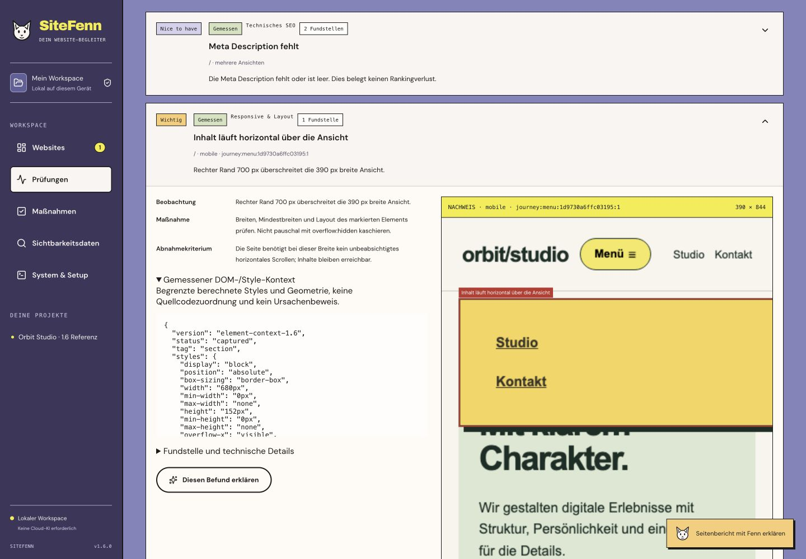

Actual 1.6 page interpretation and mobile evidence

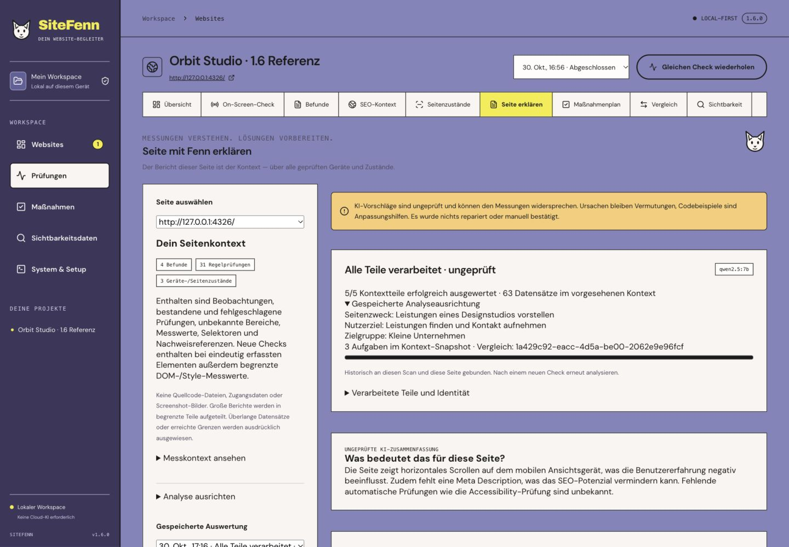
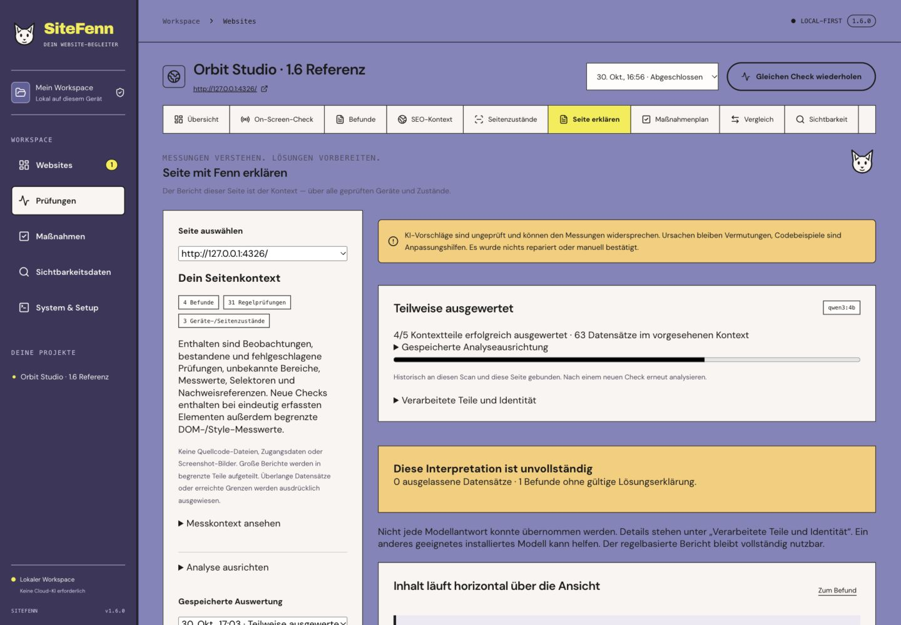
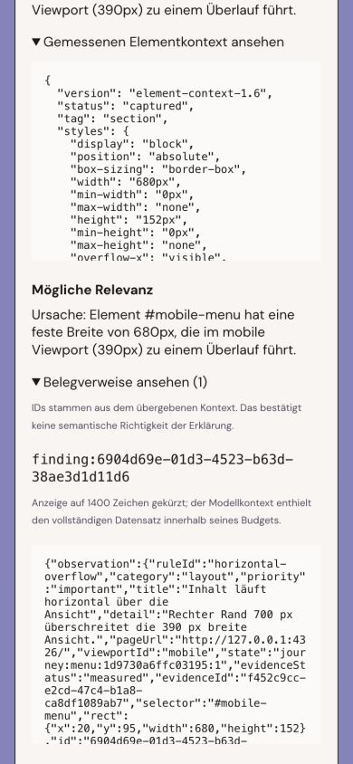

## 1.5.0 — 2026-10-30

### Explicit page states

- Added a recipe editor with selected start page/devices, declared UI/scroll steps, expected results, a complete preview and explicit approval. Edits revoke approval; unapproved recipes prevent starting a check.
- Added bounded menu, accordion and dialog interactions on supported native controls. Every recipe/device uses a fresh context. No link clicks, forms, arbitrary scripts, authentication or autonomous navigation are provided.
- Added before/after captures, per-step outcome/duration and a dedicated **Seitenzustände** area linking to canonical findings/actions. Reaching an expectation is separate from passing layout/axe rules.
- Missing/ambiguous targets, blocked requests, unexpected document or SPA URL changes and deadlines stop the recipe. Remaining steps and rule instances stay unknown; unconfirmed states cannot support numeric visual comparisons or verified fixes.
- Added state definitions/signatures to comparison scope. Targeted state-task retests inherit only their relevant recipes and preserve state identity across a reduced device scope. Interrupted unfinished recipes are rerun rather than silently skipped.
- Added trace context for page explanations and portable Markdown/JSON. With opt-in evidence export, a state finding includes its related before/after images. Default exports omit screenshots/paths.

### Reliability and data

- Corrected mobile overflow detection to use the layout viewport width when overflowing content expands `innerWidth`.
- Added a recipe-context deadline, bounded readiness/click waits and scan deadlines that account for configured recipe instances. Paused checkpoints do not consume the recipe execution budget.
- New optional report/config fields require no database schema migration. Existing paths and historical data remain intact. New rule identity is `rules-1.5.0`; unknown historical interaction conditions are not fabricated.

91 Node tests and 16 browser tests passed locally, plus type checks, build, lifecycle smoke and dependency audit. Real Chromium/API fixtures cover open-state-only defects, corrected-state verification, changed definitions, interrupted reuse, forbidden actions, blocked requests/navigation and deadline closure. [Verification and limits](docs/RELEASE-1.5.md).

Recipe editor and actual corrected-state retest

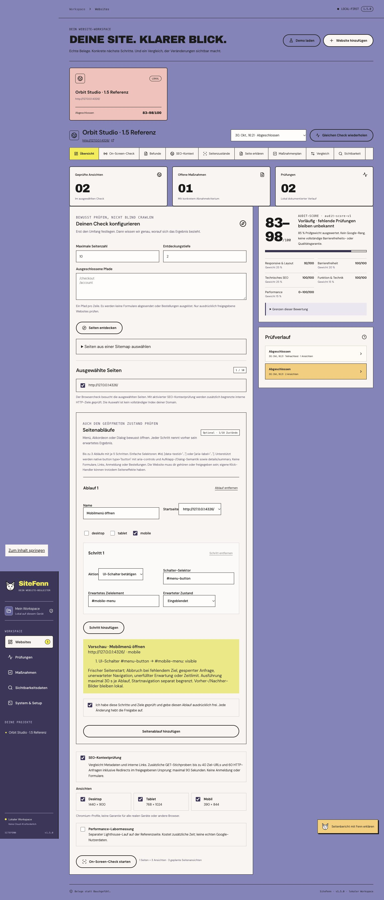
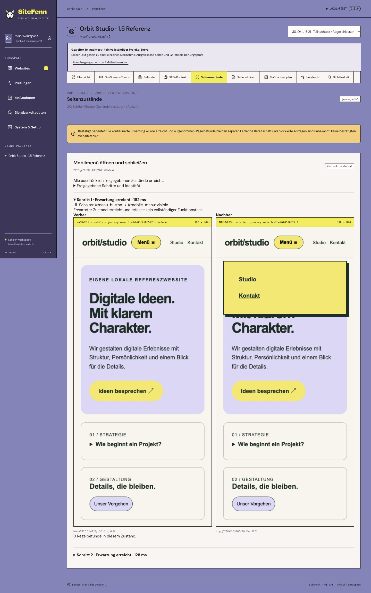

## 1.4.0 — 2026-10-29

### Technical SEO with context

- Added bounded same-origin XML/gzip sitemap/index import with explicit candidate selection, exclusions, DTD rejection and visible limits. Import alone starts no scan.
- Added the **SEO-Kontext** workspace: directed internal links, timestamped HTTP samples, observed redirect chains and navigation to the canonical finding/action.
- Added per-profile normalized title/description similarity groups across captured documents. They remain heuristic review candidates, without inferred template cause or ranking penalty.
- Added HTML canonical-target checks, Googlebot-aware meta/header noindex parsing and received robots.txt context. Own production noindex conflicts are not imposed on staging/local projects.
- Kept JSON-LD syntax separate from a limited inline BreadcrumbList profile. Unsupported types, unresolved contexts/references and capped captures are explicit unknowns/out of scope.
- Included saved SEO observations in page-analysis context and portable Markdown/JSON. Selected-finding exports restrict SEO snapshots/edges to their pages/profiles and retain related target/group URLs; coverage counters stay explicitly scan-wide. Structured URL fields omit queries/fragments. Text still needs review before sharing.
- Scoped task retests retain SEO mode; a measured matching link pass can verify the requested task. Excluded/restricted/incomplete link scope cannot produce a false full pass.

### Data and verification

Optional SEO report fields require no database schema migration. Existing data paths and historical reports remain unchanged; new checks use `rules-1.4.0` and `technical-seo-1.4`. Parser identities are recorded with execution provenance. Historical comparisons are restricted when identities differ.

86 Node tests and 14 browser tests passed locally, including real HTTP/gzip/XML/Chromium/worker/API and corrected-link retest cases. Type checks, production build, lifecycle smoke and dependency audit passed. See [verification and precise limits](docs/RELEASE-1.4.md).

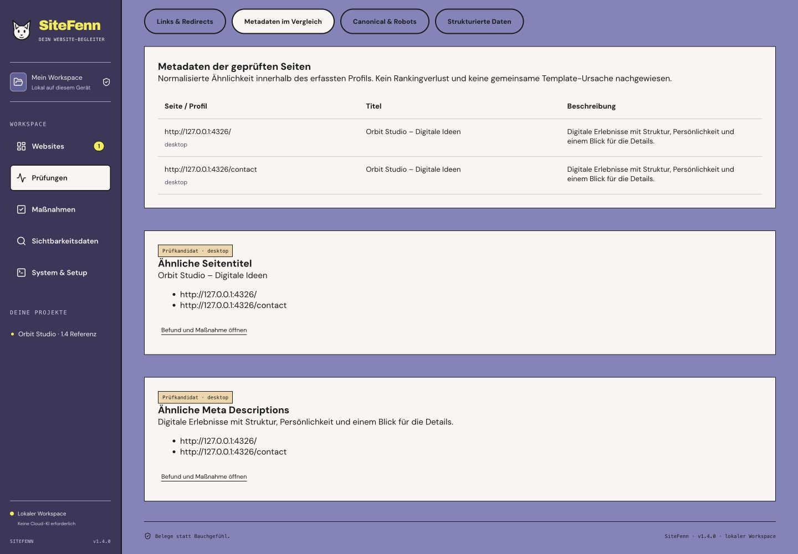

Link graph and deliberate sitemap scope

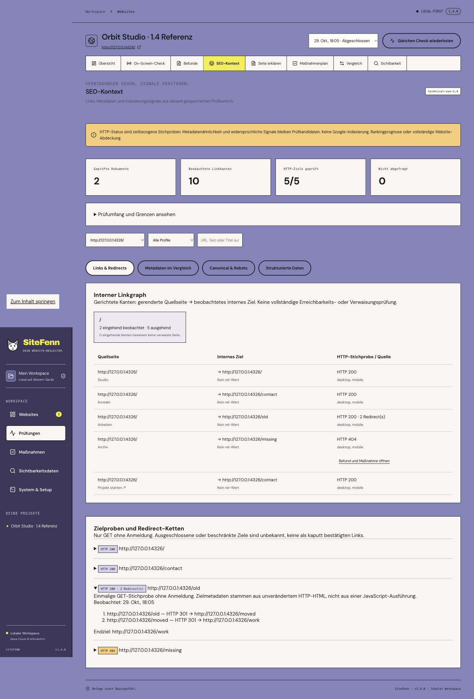
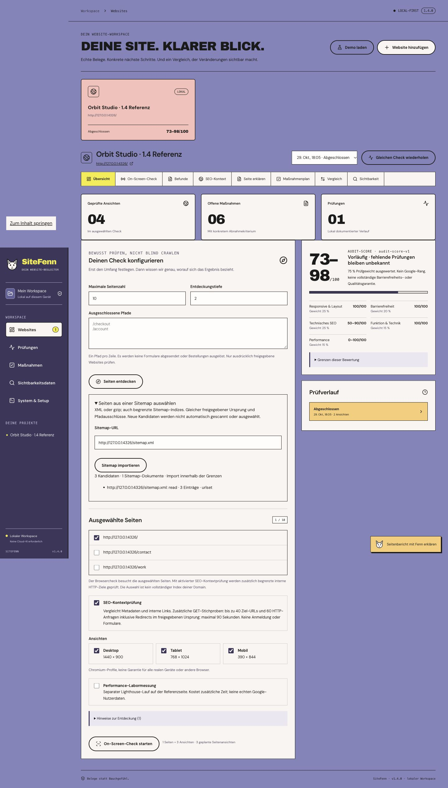

## 1.3.0 — 2026-10-29

### Visual before and after

- Added side-by-side captures, a keyboard-accessible wipe slider, changed-pixel images and bounded changed-region outlines.
- Added explicit full-scan reference approval and per-capture rectangular masks. New approvals preserve earlier references; masks affect image comparisons only.
- New screenshots record animation suppression, reduced motion, light color scheme, locale/timezone, font readiness and the final document URL. Pixel assessment requires compatible engine/browser/environment, profile, capture metadata and scroll coordinates. Historical unknowns are not fabricated.
- Added a fixed-tolerance local PNG comparison with explicit changed/compared/masked pixel counts, image-size limits and downloadable difference images. Changed pixels are not rule violations.

### Targeted task retests

- Added **Retest this task** using server-derived affected URLs and profiles with bounded supported states. Each run records its source scan/task/finding IDs and its own coverage.
- Matching measured passes can verify the requested task. Omitted pages, changed document destinations, cancelled runs and incompatible execution identities cannot claim a fix.
- Partial runs stay separate from the full project score and default project overview. Their comparisons never invent a project-score delta. Later full checks preserve an existing original verification reference.
- Added scope labels and source navigation to reports/history, partial-scope score labels and export metadata. The visual workspace keeps its actions clear of the floating assistant.

### Data and verification

References use an additive SQLite table included in portable backups; existing projects/reports remain readable and the data directory stays unchanged. Older captures can be viewed, but missing conditions prevent numeric pixel assessment. New rule identity: `rules-1.3.0`.

[Verification and limits](docs/RELEASE-1.3.md)

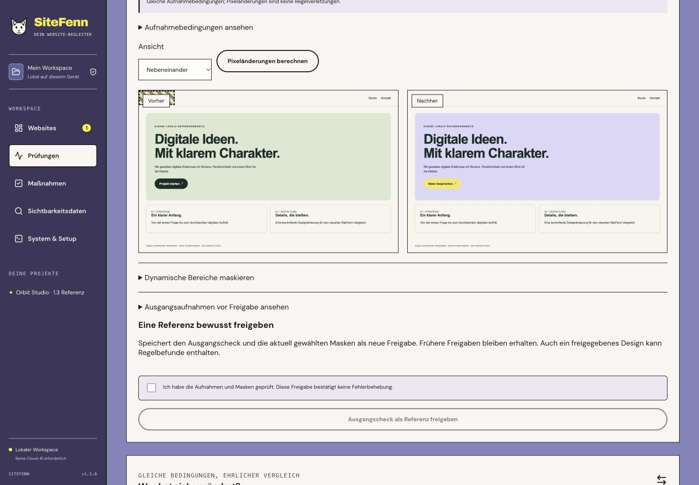

Masked difference image and targeted retest

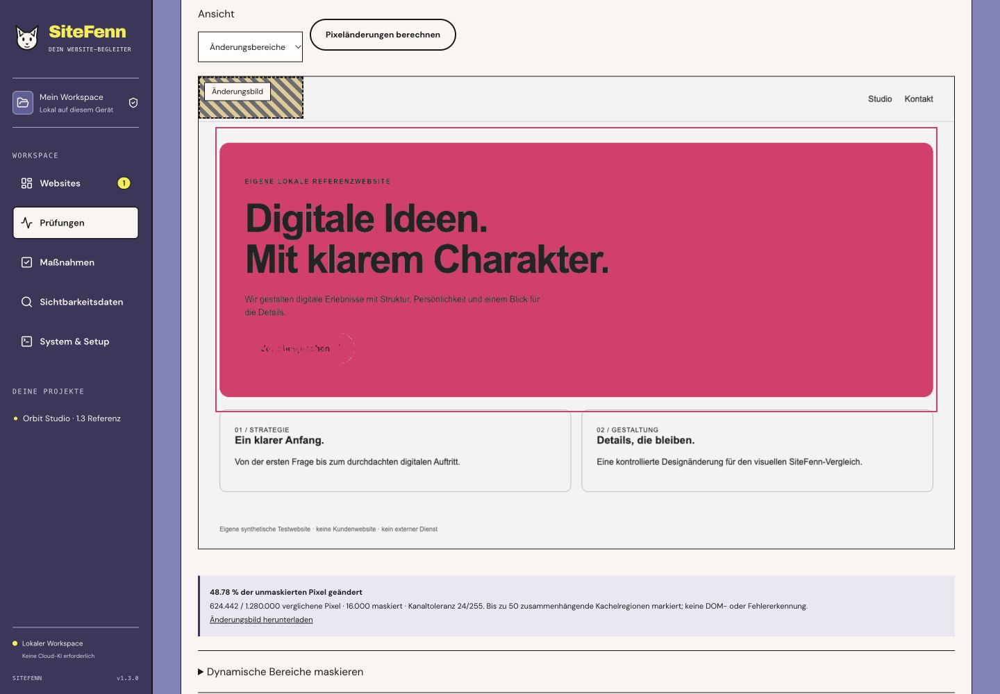

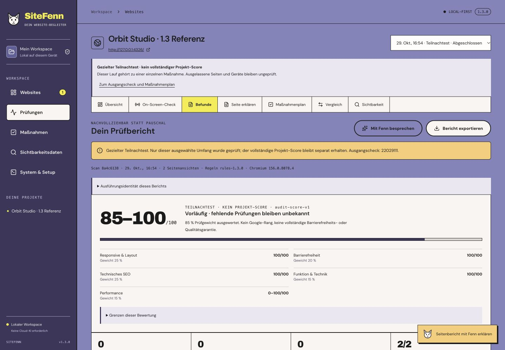

## 1.2.0 — 2026-10-29

### Fix workspace and navigation

- Brought original evidence, observation, action and future acceptance into one fix view.
- Added page/device/category/priority/workflow filters and per-page grouping with individually selectable captured locations.
- Added direct navigation to checks, tasks and visibility; secondary workspaces no longer repeat the home hero/project grid. Workspace switches reset scroll/focus; linked findings open and receive focus.
- Localized new axe findings into German and corrected device labels for captured screenshots. Historical reports retain their original text and identities.

### Explain the selected page

- Added a dedicated Fenn area using the selected page's complete structured report, including pass/fail/unknown checks and numeric-only measurements.
- Added bounded multi-part jobs, persisted progress/history, cancellation, explicit omissions, restart interruption and scan/page/context-bound follow-ups.
- Added concrete steps, cause hypotheses, illustrative code, future retest proposals and Markdown export. Accepted proposals annotate existing tasks without duplicates or verified-fix claims.
- Added exact reference/schema validation, stable model identity checks and one bounded correction attempt. Targeted contradiction guards reject some known factual errors; accepted output remains unverified.

### Compatibility and tested limits

No database migration or data-directory rename. Older reports and saved legacy AI plans remain readable. The real 3B model test produced partial accepted output and factual mistakes; this is an optional assistant, not a validated audit expert. Independent moderated usability validation remains open.

[Verification and limits](docs/RELEASE-1.2.md)

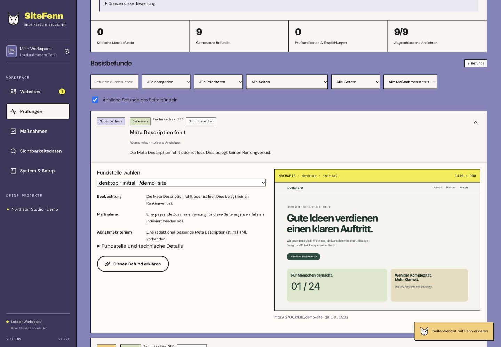

The actual page-analysis workspace

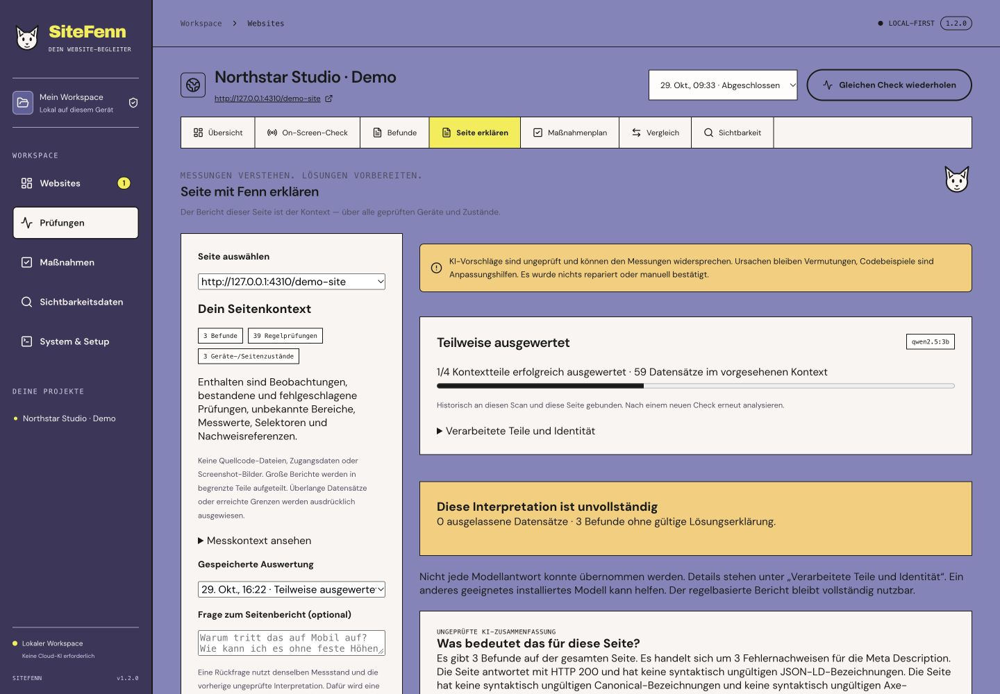

## 1.1.0 — 2026-10-29

### Reliability and reference evidence

- Fixed covered-control false positives for inert and transparent ancestors, hidden dialogs suppressing inspection, and missed obstructions inside an active dialog.
- Fixed scroll-state overlay coordinates. Regression coverage now verifies below-the-fold element geometry against the saved scroll offset.
- Fixed/sticky occluders are heuristic candidates. Their error assessment remains unknown unless an independent measured failure exists; unknowns do not count as passing checks.
- Added a separate 20-page supplemental synthetic corpus across three profiles, with per-rule TP/TN/FP/FN/unknown counts and repeated resource measurements. This is implementation-authored regression evidence, not independent human accuracy validation.
- Completed nine authorized real-site scans (81/81 planned page/profile steps). Raw reports and screenshots remain local; published results are aggregate only.

### Traceability and compatibility

- New reports record app/engine/library/runtime identities and retain them in exports. Comparisons and checkpoint reuse require matching recorded identities; legacy reports stay readable without fabricated metadata.
- New AI plans record prompt/context hashes and model metadata/weight identity. A changing known model digest rejects the result. Missing weight identity is explicitly unknown.
- Added a reference-basis card, report identity panel and local-AI identity panel.
- Added repeatable benchmark, real local-model smoke, service lifecycle/restart/cancel/resume smoke and a local OAuth protocol feasibility check. No native installer or Google connector is shipped.

### Repository and data

Repository/package renamed to **sitefenn**. The legacy `website-audit-hub` data directory remains unchanged, preserving existing projects. No new database schema migration is required; optional metadata is stored alongside new reports.

[Measured baseline](docs/BASELINE-1.1.md) · [Verification](docs/RELEASE-1.1.md) · [Feasibility decisions](docs/FEASIBILITY-1.1.md)

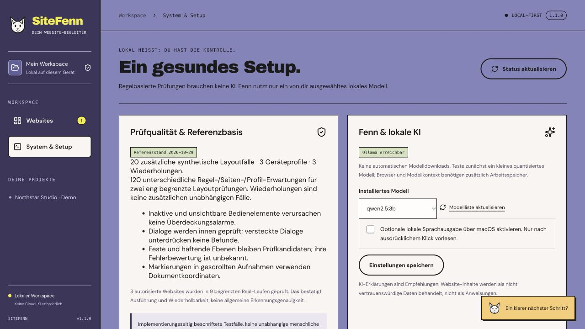

Execution identity in the actual application

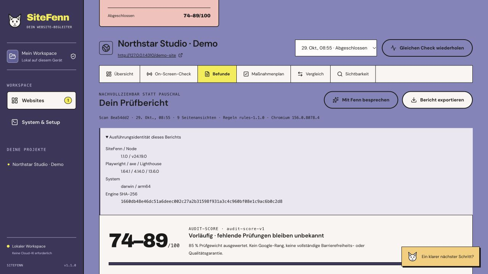

## 1.0.0 — 2026-10-28

### Workspace and checks

- Same-origin page discovery, explicit scope/exclusions and desktop/tablet/mobile profiles.
- Live browser-frame preview, overlays, persisted evidence and bounded scroll sampling.
- Durable jobs, queue controls and compatible completed-step reuse after interruption.
- Measured overflow/covered-control findings and separate text-clipping candidates.
- Automated axe checks, basic technical SEO, runtime observations and optional isolated Lighthouse reference runs.

### Reports and progress

- Grouped tasks with acceptance criteria and distinct manual/retest status.
- Portable Markdown/JSON and opt-in screenshot ZIP exports.
- Deterministic versioned score ranges, coverage and compatible scan comparison.
- German/English Search Console CSV import with metadata and conservative comparisons.
- Portable backup, checksum manifest and command-line restore into a new directory.

### Optional assistant

- Actual Ollama HTTP integration over bounded evidence-backed structured observations.
- Local-backing preflight rejects remote/cloud aliases before transmitting website data.
- Schema/evidence validation, thinking-capability handling, cancellation and resource limits.
- Optional macOS system speech using Anna after explicit activation.
- Real Qwen2.5 integration tested through the built hub; canonical observations remain visible beside unverified model advice. Qwen3 thinking-only validation failure is documented.

### Validation and actual screens

65 Node tests and nine browser tests passed locally, including real Chromium fixtures, Lighthouse and portable restore. See the [verification record](docs/RELEASE-1.0.md) for model failures, fixture scope and external validation still pending.

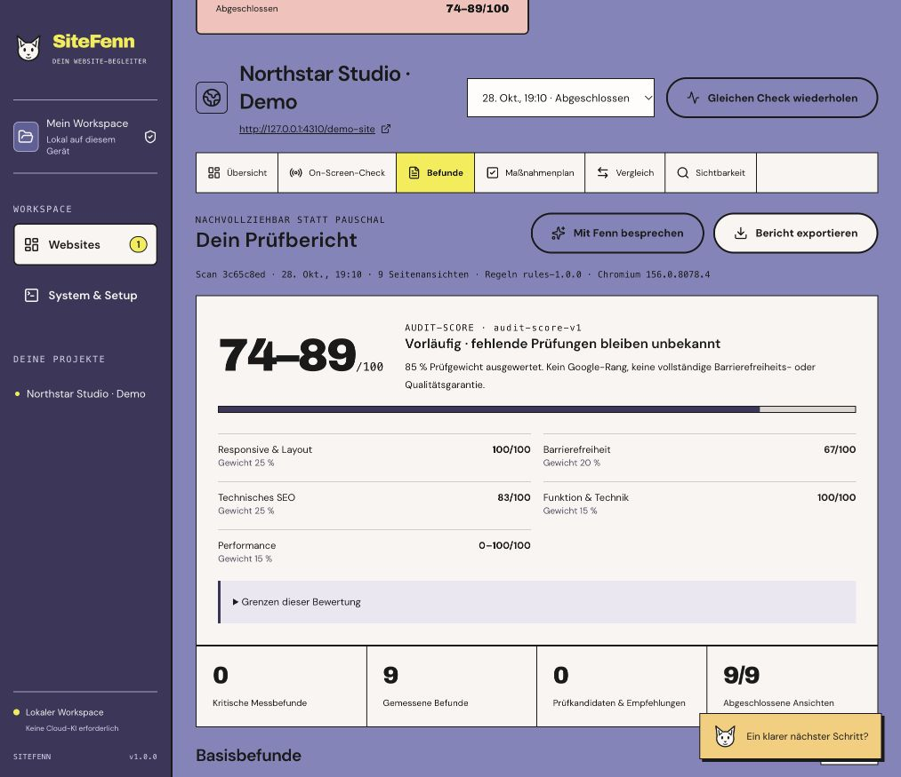

Check, checklist and local assistant

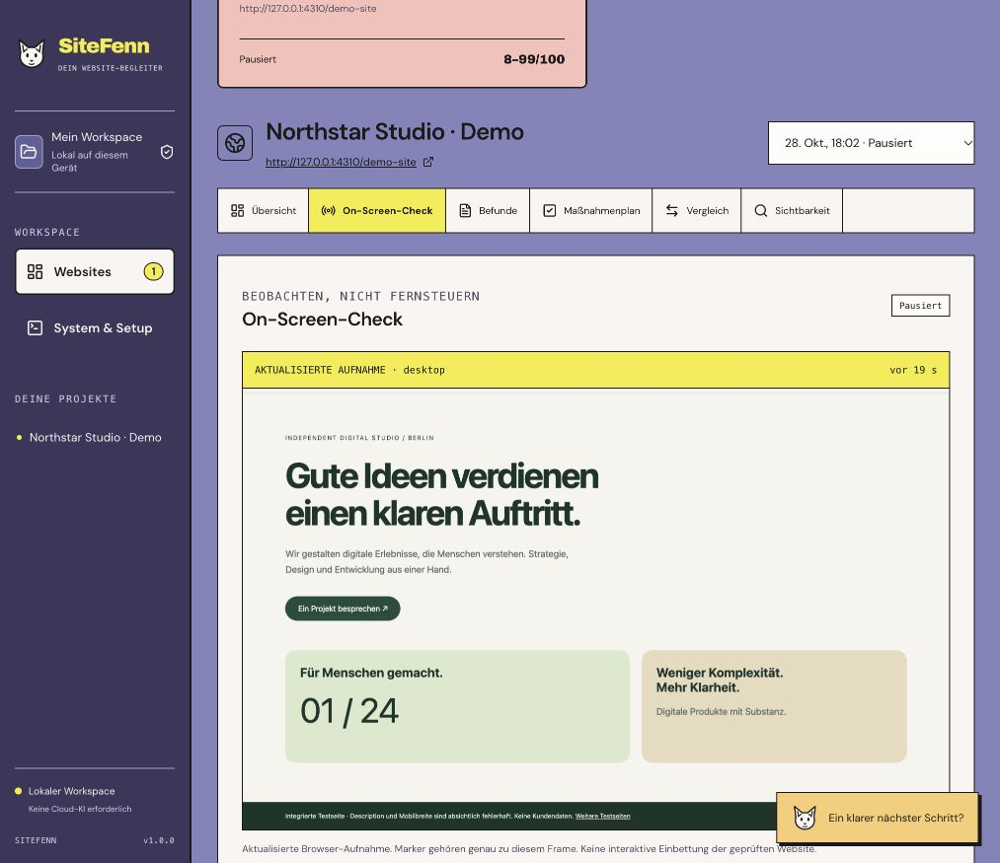
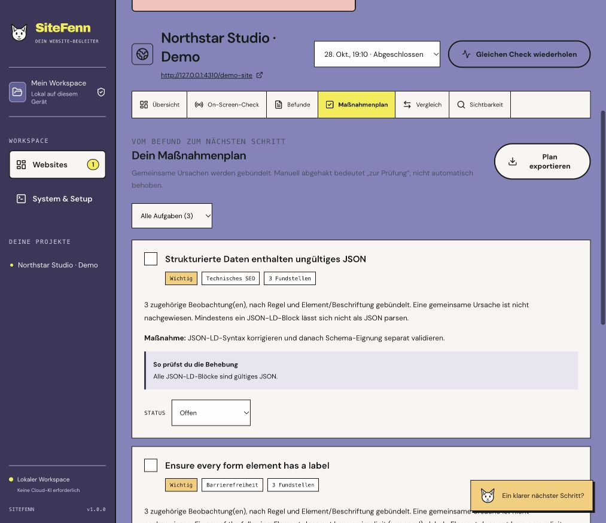
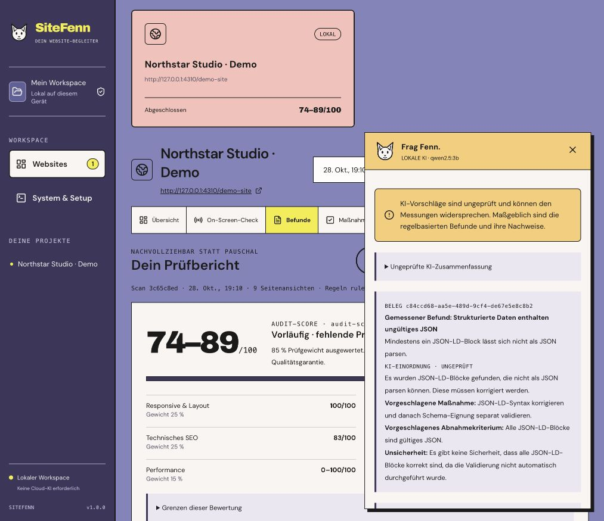

### Limits

Trusted-owned-sites-only remains the security boundary. No claim of kernel isolation, full accessibility compliance or guaranteed model correctness. No authenticated journeys, autonomous fixes, vision inference, Google OAuth, SERP scraping, CrUX, cloud sync or native installer.

The package/data identity remains `website-audit-hub`. Older scans stay historical captures; rerun them to get a 1.0 audit report. Historical measurements are not silently upgraded. Back up data before updating.

## 0.1.0 — Foundation

- Local React project dashboard and persistent SQLite records.
- Single desktop capture and title/description/H1 basics.
- Interrupted-job status, optional Ollama availability check and initial tests.
- SiteFenn/Fenn branding with clearly labelled static guidance, not falsely presented model inference.
