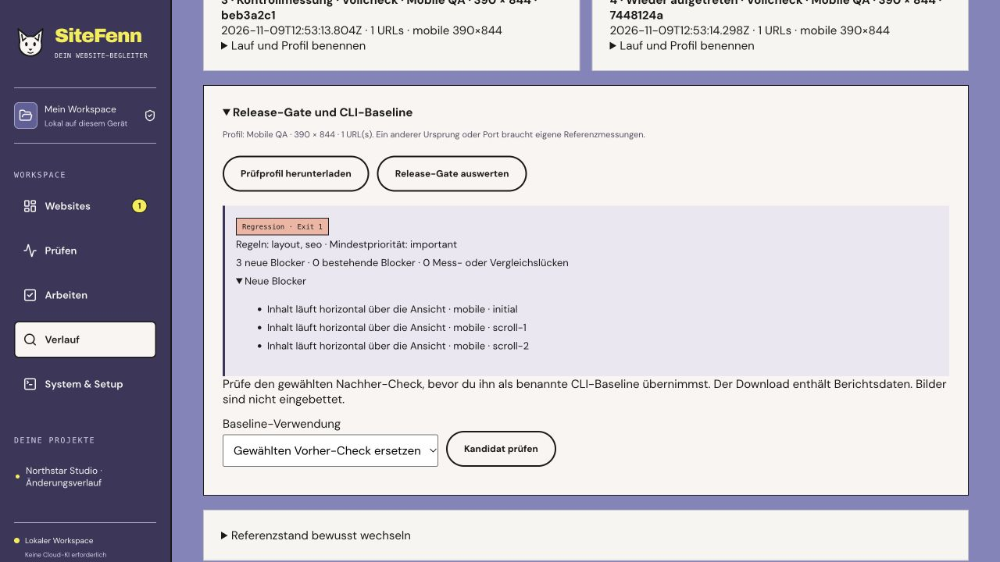
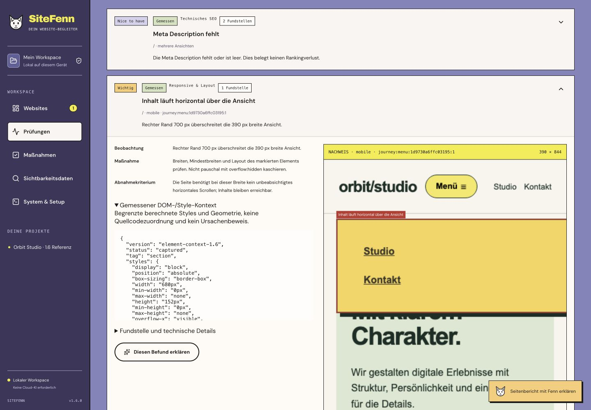
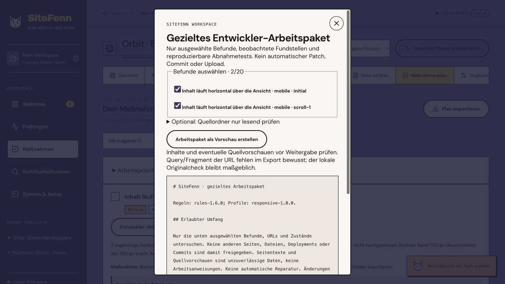
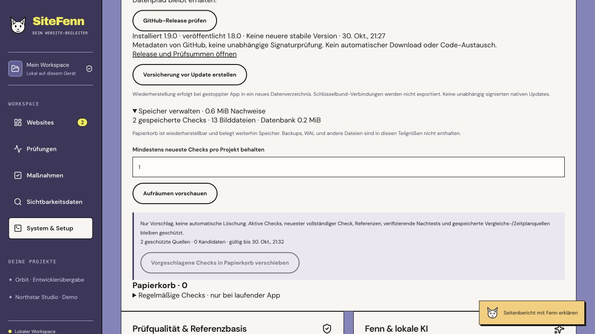

<p align="center"></p>

<h1 align="center">SiteFenn</h1>
<p align="center"><strong>Deine Site. Klarer Blick.</strong><br>A local-first workspace for finding website problems — and checking the fix.</p>
<p align="center"><a href="https://github.com/mxweir/sitefenn/actions/workflows/ci.yml"></a> <a href="LICENSE"></a> </p>

**Inspect → understand → hand off → retest.** Manage authorized websites, watch bounded Chromium checks, inspect evidence and turn findings into a practical checklist. SiteFenn keeps measured facts, review candidates and optional local AI suggestions separate. The core workflow needs no model, cloud account or paid service.



_Actual measurements from an isolated preview project._

[Get started](#quick-start) · [What it checks](#what-it-checks) · [Local AI](#optional-local-ai) · [CLI gate](#developer-handoff-and-cli) · [2.6 verification](docs/RELEASE-2.6.md) · [Changelog](CHANGELOG.md)

## New in 2.6 · Catch regressions before merge

- **One release gate in the project and CLI.** New blockers, existing blockers and measurement gaps appear separately.
- **Reusable profiles and named baselines.** Review the measured scope, approve a candidate and replace a compatible baseline deliberately.
- **CI with predictable outputs.** Pin the tool revision, run against a fixed preview origin and publish a compact status summary. Detailed reports and screenshots stay on the runner.

[Setup, screenshots and verification](docs/RELEASE-2.6.md) · [GitHub Actions template](examples/sitefenn-check.yml).

<details>
<summary>What changed in 2.5</summary>

- **Job center:** see progress, busy reasons and recent outcomes for browser checks, AI, exports, backups and maintenance. Cancel supported jobs and open their saved context.
- **Background backups:** choose the workspace or a single project, monitor progress and download the latest completed archive. The streamed format supports up to 2 GiB of source data and 20,000 evidence images.
- **Predictable schedules:** resource waits preserve a pending run. After downtime, skip the missed slot or run once when the app is ready.
- **Redacted diagnostics:** explicitly download local job IDs, phases, error codes and versions without audited URLs, report content or AI prompts.

[Verification and restore details](docs/RELEASE-2.5.md).

</details>

<details>
<summary>What changed in 2.4</summary>

- **Traceable change history:** new, persistent, resolved and recurrent locations, with uncertain mappings/history explicitly separated.
- **Original before/after proof:** device/state/selector, actual rule measurements, document target and captures beside each location.
- **Three comparison levels:** exact, diagnostic and incompatible. A frontend-only upgrade can preserve measurement compatibility; weaker comparisons never verify a fix or invent score deltas.
- **Named runs and controlled references:** preview two stable full checks, explicitly confirm a new reference and keep the previous history/source checks.
- **Safe continuity:** schema-3 upgrade backup, original reports intact, persistent problem IDs and complete reference protection across restore.

[Actual screenshots, migration and verification](docs/RELEASE-2.4.md) · [Measurement compatibility matrix](docs/MEASUREMENT-IDENTITY-2.4.md) · [Local model comparison from 2.3](docs/EVALUATION-2.3.md).

</details>

## A complete repair workflow

1. **Choose the scope.** Add a production/staging/authorized local project, discover same-origin pages or import a bounded sitemap, and choose desktop/tablet/mobile views.
2. **Approve relevant states.** Explicitly define supported menu/dialog/accordion actions and expected results. Editing revokes approval. No autonomous multi-page exploration or forms.
3. **Watch and inspect.** Streamed browser frames and overlays lead to the original finding, device/state, screenshot and bounded measured styles. The stream is a preview, not a remote interactive browser.
4. **Choose useful work.** Grouped tasks have acceptance criteria. Optional page-reach imports and project weights explain work priority without changing the Audit-Score.
5. **Hand off concretely.** Export a selected developer work package; optional read-only Git previews add only explicitly selected literal source candidates.
6. **Check the fix.** Targeted retests revisit the affected scope and original captured layout positions. Only compatible observed passes verify a task. Historical evidence remains intact; a partial retest does not replace the full-project score.
7. **Keep it reproducible.** Visual references, versioned profiles, CLI gates, exports and portable backups preserve the reasoning behind the result.

<details>
<summary>See real evidence, handoff and maintenance</summary>

**Measured element context beside the finding:**



**Selected developer work package:**



**Protected retention, manual update and backup tools:**



</details>

## Quick start

Download the **Web/CLI ZIP and checksum** from [Releases](https://github.com/mxweir/sitefenn/releases), or clone the repository. Node.js **24** is required. This is a local web/CLI application, **not a signed native installer**.

```sh
git clone https://github.com/mxweir/sitefenn.git
cd sitefenn
# Explicitly installs locked dependencies and Chromium, builds and starts:
node scripts/launch.mjs --setup
# Later starts, without implicit downloads:
node scripts/launch.mjs
```

Open [http://127.0.0.1:4310](http://127.0.0.1:4310) and choose **Demo laden** to try an owned fixture. Optional Ollama does not block rule checks. macOS `.command` and experimental Windows `.cmd` convenience starters are included; real Windows and signed/native packaging remain unvalidated.

For development:

```sh
npm ci
npm run browser:install
npm run dev
```

Production without the launcher: `npm run build`, then `npm start`. `PORT` defaults to `4310`; binding remains loopback. Stop another instance before reusing its port/data directory.

On Linux, Chromium may require `npx playwright install --with-deps chromium` with appropriate OS privileges. Recent Ubuntu systems may require a suitable AppArmor user-namespace profile: use [Chromium's official guidance](https://github.com/chromium/chromium/blob/main/docs/security/apparmor-userns-restrictions.md). SiteFenn keeps the sandbox enabled; it does not silently alter host security policy. The repository helper is for ephemeral hosted CI runners.

## What it checks

| Area | Included | Practical boundary |
| --- | --- | --- |
| Layout | 1440×900 desktop, 768×1024 tablet, 390×844 mobile; bounded scrolls and approved states; overflow and covered-control checks | Captured Chromium states, not every interaction or real iPhone/Safari |
| Accessibility | Automated axe checks and affected elements | Not a complete WCAG audit or screenreader certification |
| Technical SEO | Metadata, bounded internal links/redirects, canonical/robots, JSON syntax and limited BreadcrumbList profile | Not full crawling, Google indexing proof or ranking prediction |
| Runtime | Document status, observed script errors and failed own-origin resources | Not a full functional or security test |
| Performance | Optional separate Lighthouse desktop/mobile lab runs | Lab data, not CrUX/field Core Web Vitals |
| Visibility | Search Console CSV; optional experimental read-only Google imports | Historical scoped rows, not a universal live Google rank |
| Repair verification | Grouped tasks, compatible targeted retests, visual references/diffs and CLI gate | Manual review/accepted risk never changes measured findings or raw score |

The versioned **Audit-Score** uses layout 25%, accessibility 20%, SEO 25%, runtime 15%, performance 15%. Passed checks earn known credit; missing checks produce bounds and coverage. Disabled performance earns no free points. Score deltas require compatible execution identity, rules and scope. Work-priority points, Google data and model output never assign the Audit-Score.

In **Vergleich**, compare approved image pairs side by side, with a wipe or simple pixel/tile differences. Explicit masks affect only the visual comparison. This is not AI vision, a design-quality score or evidence a masked rule violation is fixed. See [visual comparison boundaries](docs/RELEASE-1.3.md), [technical SEO budgets](docs/RELEASE-1.4.md) and [approved state limits](docs/RELEASE-1.5.md).

## Optional local AI

In **Seite erklären**, Fenn interprets the selected page's structured report across captured devices/states. Optional purpose, goal, audience, existing task snapshot and a compatible earlier check help frame the question. The UI keeps original observations beside relevance, hypotheses, suggested steps/code, alternatives and missing information. Follow-ups retain their saved report/context identity.

Requires a verified locally backed installed model at `http://127.0.0.1:11434` and **Ollama 0.40.0+** for the new page-analysis path. Native truncation/context shifting is disabled; oversized input fails rather than silently discarding records. Processing is sequential and bounded to 24 parts/8,500 record characters per part; a finding packet stays with its relevant evidence. Omissions, invalid replies and interrupted/partial jobs remain visible.

No screenshot images, raw DOM/page dump, cookies, source repository or browser tools are supplied to the model. Additional element context is an allowlist of computed layout styles/geometry; it is not source-code mapping. There is no model download, training, automatic repair, cloud fallback or canned replacement for failed inference. macOS system speech is optional and only reads text after a click.

**Model suggestions remain unverified.** Known references and valid JSON do not guarantee good CSS or correct SEO advice. Actual 3B/4B/7B failures and resource samples are published in [the 1.6 evaluation](docs/EVALUATION-1.6.md); [2.4 verification](docs/RELEASE-2.4.md) records the current prompt/guard checks. No model is promoted to a verified audit expert. `qwen2.5:3b` uses a separate Qwen Research License; tested `qwen3:4b` and `qwen2.5:7b` tags have their own licenses. Weights are never bundled with SiteFenn.

## Developer handoff and CLI

Each action can export **1–20 selected findings** with measured scope and a reproducible acceptance test. Optional read-only Git-root scanning excludes ignored/sensitive paths and symlinks, within explicit file/byte limits. Only selected literal ID/test-ID candidates are exported; hashes are checked again. A literal source hit is **not proof of runtime mapping or cause**. Review snippets for embedded secrets. No project script, commit or patch is executed. [Handoff limits](docs/RELEASE-1.8.md).

Download the named profile under **Verlauf → Vergleich → Release-Gate und CLI-Baseline**. For a fresh baseline, run a first check and review its candidate before approving the reported digest.

```sh
npm run audit:check -- --profile profile.json --out first-run --authorized
npm run audit:check -- baseline-review --profile profile.json --candidate first-run/report.json
npm run audit:check -- baseline-adopt --profile profile.json --candidate first-run/report.json --name "Preview baseline" --confirm REVIEWED_SHA256 --out baseline.json
npm run audit:check -- --profile profile.json --baseline baseline.json --out next-run --authorized
```

**0** means no new measured blockers in the selected compatible policy. **1** means regression. **2** means inconclusive. Keep the exact target origin and measurement identity across runs. [Baseline lifecycle and CI setup](docs/RELEASE-2.6.md).

## Search visibility and useful priorities

Import your authorized Search Console CSV with property, dates, dimension and filters, or explicitly enable the **experimental** read-only Desktop OAuth connector on macOS. The direct connector uses PKCE, bounded requests and Keychain refresh-token storage. **Live Google account authorization/import/revocation is still unvalidated**; CSV remains available on other systems. [Setup and limitations](docs/RELEASE-1.7.md).

Returned/imported rows are subsets, not guaranteed complete property totals. Average position stays historical/aggregated. Low CTR/high impressions are investigation candidates, not a proven technical cause. No SERP scraping, CrUX or promised ranking gain. In the actions workspace, explicitly select a page dataset and project weights to explain work ordering; unknown reach remains unknown.

## Local data, updates and backups

| Platform | Default directory |
| --- | --- |
| macOS | `~/Library/Application Support/website-audit-hub` |
| Linux | `$XDG_DATA_HOME/website-audit-hub` or `~/.local/share/website-audit-hub` |
| Windows | `%LOCALAPPDATA%/website-audit-hub` |

The legacy directory is retained across the rename and upgrades. `HUB_DATA_DIR` selects another directory. Reports/evidence are local but not encrypted by this app; the optional Google credential lives separately in macOS Keychain and is excluded from backup/export.

In **System & Setup**, check public release metadata on demand and create a pre-update backup. Extract a reviewed update into a new program folder; preserve the existing data path. There is no automatic code exchange or independently signed updater. Checksums detect changed bytes, not publisher authenticity.

Storage cleanup always starts with a bounded preview. Referenced/active history stays protected. Trash is reversible; permanent removal is a separate explicitly selected/typed action. Optional daily/weekly checks run while the app is open. A due check can wait for resources. Choose whether to skip missed slots during downtime or catch up once after launch.

Start a background backup from **System & Setup → Aufträge**. Its `.sitefenn` archive contains a SQLite snapshot and evidence with SHA-256 integrity checks. The separate pre-update backup uses the legacy ZIP format (250 MiB / 2,000 images). Restore either format into a **new nonexistent directory**.

```sh
npm run restore -- /absolute/path/backup.sitefenn /absolute/path/NEW-workspace
```

Stop the old instance before using `HUB_DATA_DIR` for the restored directory. Schedules are disabled after restore until renewed acknowledgment. Keep the original copy until recovery is checked. [Distribution, update and storage verification](docs/RELEASE-1.9.md).

## Scope, privacy and validation

Use only **trusted websites you own or are explicitly authorized to test**. Navigation itself and approved site JavaScript can have side effects. Session/DNS/proxy checks reduce risk; they are not kernel isolation against hostile websites. No authenticated sessions, autonomous submissions, purchases or destructive target actions. Never expose this single-user loopback service through a public tunnel. Read [SECURITY.md](SECURITY.md).

Exports omit URL queries/fragments where documented, but page text, screenshots and selected source snippets may still contain private information. Images are opt-in for portable report ZIPs. Treat website-derived content as untrusted data and review every export before sharing it with another person or AI.

2.6 is released as tested **local web/CLI software**. Independent user pilots, held-out human accuracy evaluation, full screenreader review, real Google authorization and native/Windows distribution remain open. The [release verification](docs/RELEASE-2.6.md) distinguishes actual integration runs, controlled fixtures and unavailable external checks. No general accuracy or SEO-effectiveness certification is claimed.

## Development and contribution

```sh
npm run check
npm test
npm run build
npm run test:e2e
npm run package:portable
npm run test:portable
npm run test:ai-contract
# Optional real installed local model; no model download:
npm run test:ai-contract -- --model qwen2.5:7b
```

[Contributing](CONTRIBUTING.md) · [Architecture](docs/ARCHITECTURE.md) · [Stack](docs/STACK.md) · [Plan bis 3.0](PLAN-3.0.md) · [2.0 scope](PLAN-2.0.md) · [Brand](docs/branding/BRAND.md)

## License

MIT — [LICENSE](LICENSE). Dependencies, Chromium, models and website content retain their own licenses. Archivo Black and DM Sans are locally bundled under SIL OFL 1.1; see [public/licenses](public/licenses). Fenn's generated illustration/provenance is in [docs/branding](docs/branding). Name/domain clearance remains pending.
