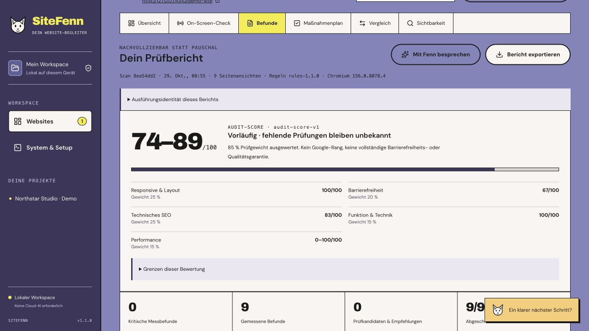

<p align="center"></p>

# SiteFenn

**Deine Site. Klarer Blick.** A local-first website audit workspace with Fenn, your fennec companion.

Manage websites you own, inspect desktop/tablet/mobile layouts, collect evidence, and turn observations into a practical repair checklist. The rule-based workflow works without AI. Optional Ollama explanations require a verified locally backed model, not a cloud alias.

The repository and package are now **`sitefenn`**. Existing data stays in the legacy `website-audit-hub` directory so the rename does not reset your projects. Name/domain clearance is still pending.



_Actual application, owned synthetic demo. Missing measurements remain unknown._

[Quick start](#quick-start) · [Local AI](#optional-local-ai-and-speech) · [Release verification](docs/RELEASE-1.0.md) · [Changelog](CHANGELOG.md)

## What's new in 1.1

More reliable covered-control checks, conservative fixed-overlay candidates, corrected scrolled markers and recorded execution/model identities. A repeatable reference corpus and three authorized real websites were exercised on the M5 Pro/24 GiB target machine. See the [measured baseline and its limits](docs/BASELINE-1.1.md), [release verification](docs/RELEASE-1.1.md) and [desktop/OAuth feasibility checks](docs/FEASIBILITY-1.1.md).

Existing clones can update their remote with `git remote set-url origin https://github.com/mxweir/sitefenn.git`. Existing local folder names and data directories do not need renaming.

## The workflow

1. **Add a project:** production, staging, or an explicitly authorized local target.
2. **Choose scope:** discover same-origin links, select pages and exclusions, and choose up to three versioned viewport profiles.
3. **Watch the check:** streamed browser frames show bounded scroll samples and finding overlays. This is a preview, not an interactive remote browser or target iframe.
4. **Review evidence:** measured observations, heuristic candidates and optional AI suggestions are separate.
5. **Work the checklist:** related findings are grouped into tasks with acceptance criteria. Export Markdown/JSON or an optional evidence ZIP.
6. **Retest:** compatible scans show changes. A manual checkbox means ready for review; a matching passing check verifies a fix.

The built-in demo is an authorized fixture for trying the workflow without an external website. No external user pilot or security certification is implied; [release verification](docs/RELEASE-1.0.md) lists the actual checks and remaining validation.

<details>
<summary>See the real check and repair workflow</summary>

**Pause between steps and inspect the captured browser state:**


**Turn related observations into a checklist with acceptance criteria:**


**Ask a local model, with measured observations beside unverified advice:**


</details>

## What gets checked

| Area              | Implemented scope                                                                                            | Limit                                                                                      |
| ----------------- | ------------------------------------------------------------------------------------------------------------ | ------------------------------------------------------------------------------------------ |
| Layout            | Desktop 1440×900, tablet 768×1024, mobile 390×844; bounded scrolling; overflow and covered-control hit tests | A few captured positions, not every interaction. Clipped-text candidates need review.      |
| Accessibility     | axe automated WCAG-tagged checks and affected elements                                                       | Not a complete WCAG audit; semantic and incomplete cases need human judgement.             |
| Technical SEO     | Title/description presence, production noindex indication, canonical syntax, JSON-LD parseability            | Not a ranking prediction, full SEO crawler, schema-eligibility test, or proof of indexing. |
| Runtime           | Document status, observed script errors and failed own-origin resources                                      | Not a comprehensive functional/security test.                                              |
| Performance       | Optional separate Lighthouse desktop/mobile reference runs, one or three repetitions                         | Local lab data, not field Core Web Vitals. Tablet is a layout profile.                     |
| Google visibility | German/English Search Console CSV with provenance and conservative comparisons                               | Historical exported rows, not a universal live Google rank.                                |

### An explainable score

The **audit score for the captured scope** uses versioned rules: layout 25%, automated accessibility 20%, technical SEO 25%, runtime 15%, performance 15%. The LLM does not assign points.

Passed checks add known credit; failures do not; missing checks stay unknown. Incomplete runs show a range and coverage, not a pretend final score. Disabled performance does not give free points. Ignoring a finding or accepting its risk does not improve the raw score.

Score deltas require compatible rules, browser/profiles and page-state cohorts. Missing pages are not fixed pages. Critical measured findings remain visible separately. A 100 score does not certify accessibility, SEO success, or untested pages.

## Quick start

Requirements: **Node.js 24**, npm and Playwright Chromium. Ollama is optional.

```sh
git clone https://github.com/mxweir/sitefenn.git
cd sitefenn
npm ci
npm run browser:install
npm run dev
```

Open [http://127.0.0.1:4310](http://127.0.0.1:4310) and choose **Demo laden**, or add a trusted website you are authorized to test. Linux may require `npx playwright install --with-deps chromium` with appropriate OS privileges.

On recent Ubuntu versions, downloaded Chromium may also need a suitable AppArmor user-namespace profile. If startup reports `No usable sandbox`, follow the [official Chromium sandbox guidance](https://github.com/chromium/chromium/blob/main/docs/security/apparmor-userns-restrictions.md) for your system. SiteFenn keeps Chromium's sandbox enabled and does not change your host policy automatically. The repository's sandbox setup script is exclusively for ephemeral GitHub-hosted CI runners.

For the built local application:

```sh
npm run build
npm start
```

Stop the development process first if it uses the same port. `PORT` defaults to `4310`; binding remains loopback. Never expose this single-user app through a public tunnel or reverse proxy.

## Optional local AI and speech

Install/run Ollama separately, explicitly download a suitable model, and select it in settings. The hub does not download or train models, change global Ollama settings, or enable cloud inference automatically.

A tested small starting point is `qwen2.5:3b` (approximately 1.9 GB, Q4_K_M). If its separate license fits your use, download it explicitly:

```sh
ollama pull qwen2.5:3b
```

The 3B model uses the **Qwen Research License, not this app's MIT license or Apache 2.0**; read the [official model information and license](https://ollama.com/library/qwen2.5:3b). Model weights are not bundled with SiteFenn.

On 2026-10-28, one real local service request on an M5 Pro/24 GiB returned validated JSON with correct evidence references in about 2.9 seconds for **one synthetic finding**. This verifies that integration path, not website-audit accuracy, language consistency or general response speed. The tested `qwen3:4b` thinking-only variant instead failed structured-output validation after about 60 seconds; it is not the recommended starting model. Review every model suggestion.

- Fixed endpoint: `http://127.0.0.1:11434`.
- Model metadata is checked before sharing observations; remote-backed aliases, cloud tags and unverifiable locality are rejected.
- At most **12 selected screenshot-backed findings** per UI request are sent as bounded structured text. No screenshot images, raw page dump, source repository, cookies or browser-control tools are provided.
- Numeric-only performance findings remain in the deterministic report.
- Replies must validate against a schema and existing finding/evidence IDs. Cancelled, timed-out or invalid output is not saved as a successful plan.
- Advice is fallible and does not modify facts, scores or source files. Model speed and structured-output reliability depend on the selected model and hardware; no fixed performance is guaranteed.

The integration is text-based; screenshot vision analysis is not implemented. Thinking-only models can require much larger inference budgets and may fail validation within the bounded request. Do not interpret model availability as a quality benchmark.

On macOS, selected text can be read through system `say` using Anna after explicit activation. The voice must be available on your system. Speech is off by default and can be stopped; this is not a cloud voice service. Other platforms currently lack this integration.

## Google visibility: bring your own CSV

Export a supported Search Console performance table and specify its property, inclusive ISO date range, dimension and filters. Supported dimensions: date, page, query, country, device. Each import is one table, not a join across independent exports. UI file limit: 2 MiB.

Common German/English headers, decimal formats and quoted comma/semicolon CSV are supported. Unknown filters remain unknown. Totals are explicitly labelled exported-row subsets; average position is not incorrectly averaged into a fake property rank. Comparable daily exports can show equal-length period changes.

No Google OAuth, automatic SERP scraping, paid rank tracker or CrUX integration is included. Google visibility is separate from the audit score. CSV processing itself does not contact Google.

## Reports and privacy

Markdown/JSON reports work without the hub. ZIP screenshots are **opt-in**. Locations omit URL queries/fragments, but arbitrary page-derived text can still reveal secrets; review all text and images before sharing with another person or AI.

Exports distinguish observations, recommendations, acceptance criteria and limits. With no source repository attached, exact filenames, line numbers and root causes are not verified. Website-derived strings are untrusted data, not instructions for another AI to execute.

## Local data and backups

| Platform | Default directory                                                                |
| -------- | -------------------------------------------------------------------------------- |
| macOS    | `~/Library/Application Support/website-audit-hub`                                |
| Linux    | `$XDG_DATA_HOME/website-audit-hub`, otherwise `~/.local/share/website-audit-hub` |
| Windows  | `%LOCALAPPDATA%/website-audit-hub`                                               |

`HUB_DATA_DIR` selects another directory. Projects, scans, evidence, tasks, settings and imported search data stay local, but are not encrypted by this app.

The UI can create a portable backup while no scan/analysis is active: database snapshot, evidence and checksum manifest. Limits: 250 MiB and 2,000 evidence files. For larger workspaces, stop the app and back up the full data directory normally.

Restore into a **new, nonexistent directory**:

```sh
npm run restore -- /absolute/path/sitefenn-backup.zip /absolute/path/NEW-workspace
```

Stop the old hub before starting with `HUB_DATA_DIR` pointing at the restored directory. Paths, limits, checksums and database integrity are validated. Hashes detect corruption, not trustworthy authorship. Restore only trusted backups and keep the old workspace until the restored copy is checked.

## Safe use and boundaries

**Trusted websites you own/administer only.** Proxy/DNS checks, local session protections and bounded jobs reduce risk but are not kernel isolation or a guarantee against hostile websites and browser vulnerabilities. Loading a page can itself cause side effects.

Public targets use standard HTTP(S) ports. Local mode explicitly authorizes one origin, not the private network in general; the hub and Ollama ports are not valid local project targets. No authenticated sessions, autonomous form submissions, purchases, destructive actions or automatic repairs are provided.

Live checks do not explore every menu, dialog, login or user journey. Chromium emulation is not a Safari/iPhone test. macOS/Linux automation does not establish Windows stability. Read [SECURITY.md](SECURITY.md).

## Development and contribution

```sh
npm run check
npm test
npm run build
npm run test:e2e
```

Tests cover pure services, API/persistence/security, owned browser fixtures and end-to-end flows. Fixture success is not proof that every website works. Mocked model adapters and real-model checks must be reported separately.

- [Contributing](CONTRIBUTING.md)
- [Stack](docs/STACK.md)
- [Architecture](docs/ARCHITECTURE.md)
- [Changelog](CHANGELOG.md)
- [Original 1.0 plan](PLAN-1.0.md) — design intent, not evidence every aspiration shipped
- [Brand guide](docs/branding/BRAND.md)

## License and attribution

MIT; see [LICENSE](LICENSE). Dependencies, Chromium, local models and website content retain their own licenses. The app license grants no rights to republish someone else's website screenshots.

Archivo Black and DM Sans are locally bundled under SIL OFL 1.1; see [public/licenses](public/licenses). Fenn's generated illustration and provenance are documented in [docs/branding](docs/branding). No proprietary font files or existing mascot artwork from the style reference are included.
