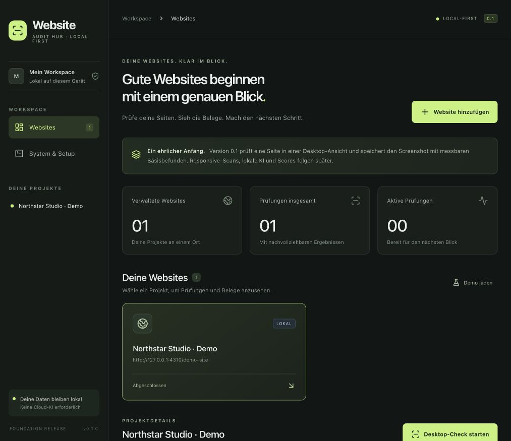
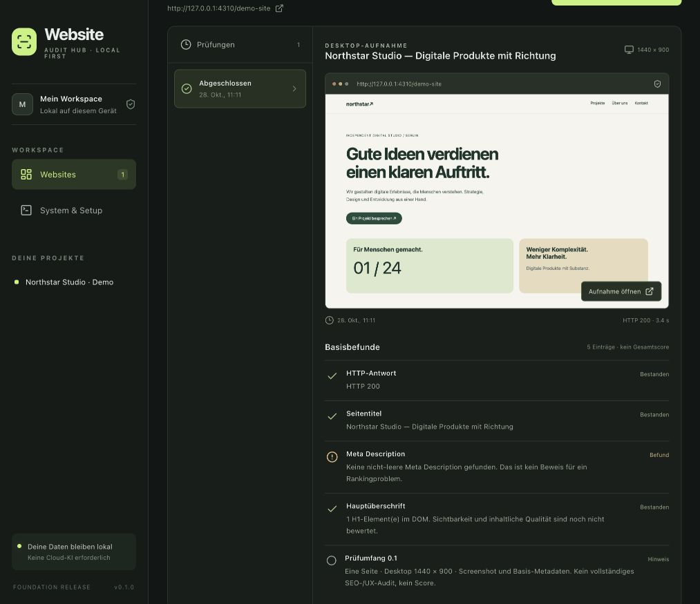

# Website Audit Hub

A local-first workspace for inspecting websites you own or administer. Save projects, run a small browser-based check, and keep the evidence locally.

**Version 0.1 is a foundation release, not a complete website auditor.** It captures one desktop screenshot and checks basic page metadata. The planned responsive audit, live browser view, explainable scores, scan comparisons, local AI recommendations, and Google Search Console integration are not implemented in this release.



## What 0.1 does

- Create and list website projects in a local dashboard.
- Run a single-page Chromium check for a saved project.
- Capture a desktop screenshot and inspect the page title, meta description, and H1 headings.
- Persist projects, scan status, and findings in SQLite; keep screenshot files locally.
- Mark unfinished work as interrupted after an application restart instead of claiming it completed.
- Optionally check whether Ollama is available at its local endpoint. No model download, training, or AI analysis is performed.

A missing metadata field is a basic observation, not a ranking prediction. Screenshots and checks cover the captured state only. This release does not certify SEO quality, usability, accessibility, or security.

## Requirements

- Node.js 24 and npm.
- A supported desktop environment for Playwright's Chromium browser.
- Internet access for initial dependency/browser installation and for visiting remote websites.
- Ollama is optional. A running model is not required to use the application.

The local dashboard and stored reports do not require a cloud AI API. Visiting a website still sends normal browser requests to that website and its resources.

## Quick start

```sh
git clone https://github.com/mxweir/website-audit-hub.git
cd website-audit-hub
npm install
npm run browser:install
npm run dev
```

Open [http://127.0.0.1:4310](http://127.0.0.1:4310) and choose **Demo ausprobieren** for a self-contained first scan. Alternatively, add a trusted public website you own or administer and start a scan from its project view. Private/local addresses and nonstandard ports are blocked in 0.1; the built-in demo is the only local-target exception.



The application is intended to run locally. Do not expose its port through a reverse proxy, public tunnel, shared network binding, or Internet-facing deployment. It is not a multi-user service.

### Production-mode local run

```sh
npm run build
npm start
```

The built application uses the same local address and port. Stop the development process before starting production mode on that port.

## Local data

By default, application data lives outside the repository:

| Platform | Default directory |
| --- | --- |
| macOS | `~/Library/Application Support/website-audit-hub` |
| Linux | `$XDG_DATA_HOME/website-audit-hub`, or `~/.local/share/website-audit-hub` when unset |
| Windows | `%LOCALAPPDATA%/website-audit-hub` |

Set `HUB_DATA_DIR` to choose another location. `PORT` can change the default port, `4310`; the server remains bound to loopback. Ollama status checks use `http://127.0.0.1:11434`.

Screenshots may contain confidential page content. Choose a private storage location, keep reports out of public repositories, and review artifacts before sharing them. Local storage is not a promise of encryption at rest. To make a consistent manual backup, stop the application and copy its entire data directory, including the database and screenshot files.

## Safe use and current limits

**Scan only trusted websites that you own or are authorized to test.** An automated browser executes page JavaScript. This early release is not hardened for arbitrary hostile URLs, and full browser/network egress isolation is not implemented. Do not use it to scan unknown sites or sensitive internal applications.

- One desktop page capture; no multi-resolution crawl or live video stream yet.
- No login-flow automation, form submission, purchasing, or autonomous repair.
- No overall score or claim that every issue has been detected.
- No Google rankings, Search Console data, or cloud synchronization yet.
- No source-repository analysis or exact source-file repair suggestions yet.
- Basic local operation does not imply immunity to malicious content or browser vulnerabilities.

Read [SECURITY.md](SECURITY.md) before running scans.

## Development

```sh
npm run check
npm test
npm run build
npm run test:e2e
```

Keep tests and documentation aligned with the actual release scope. New findings should distinguish observed facts from inferred causes and suggestions. Do not add scores or claims of automatic compliance without documented rules and tests.

End-to-end tests start an isolated production-mode server and execute a real Chromium scan of the built-in fixture. Unit/API tests cover persistence, interrupted scans, local session/CSRF checks, target validation, and malformed requests. CI runs checks on Linux and macOS; Windows stability is not yet verified.

- [Stack](docs/STACK.md)
- [Architecture and trust boundaries](docs/ARCHITECTURE.md)
- [Plan through 1.0](PLAN-1.0.md)
- [Changelog](CHANGELOG.md)

## License

MIT. See [LICENSE](LICENSE). Dependency and browser licenses remain their own. The application license does not grant rights to republish scanned website content or screenshots.
