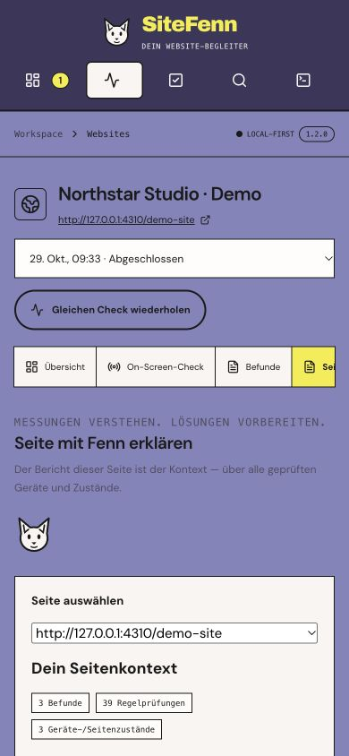

# SiteFenn 1.2 verification

2026-10-29. Local macOS Apple M5 Pro, 24 GiB RAM. The release adds the fix workspace and the first report-per-page assistant flow. This record separates deterministic integration checks, actual model behavior and outstanding human validation.

## Implemented and checked

- `npm run check`: passed.
- `npm test`: 76/76 passed. Seven page-analysis tests cover full page context beyond twelve findings, pass/unknown/numeric records, explicit omissions, bounded correction, known contradiction rejection, cancellation/restart, persistence, Markdown and deduplicated adoption.
- `npm run build`: passed.
- `npm run test:e2e`: 10/10 passed. Actual Chromium/demo/evidence/export flows are combined with mocked-provider UI tests for code, follow-ups, adoption, partial output and cancellation. Provider mocks are not a model-quality test.
- `npm run test:readiness -- .local-data/readiness-1.2-final`: passed. Actual Node service restart/cancel/resume smoke and the existing local OAuth protocol contract. No native package or Google authorization is implied.
- `npm audit --audit-level=high`: zero reported vulnerabilities at test time.
- Actual browser review: original screenshot next to action/acceptance, selectable grouped locations, German axe text, saved analysis after restart and page context/error display. At 390 px, document width was 390 px; this is not a full accessibility audit.

CI runs the static, Node, build, lifecycle and Chromium checks on macOS and Ubuntu. Real-model inference is deliberately separate and opt-in. See the [CI runs](https://github.com/mxweir/sitefenn/actions/workflows/ci.yml).

## Actual local-model findings

`qwen2.5:3b` was exercised through the actual Ollama HTTP API with the actual owned demo report. The selected page contains 59 structured records, 39 rule instances and three viewport-specific findings, processed in four parts. No website screenshot images or source repository were sent.

Early runs exposed false claims of error-free pages, confusion between future acceptance and observed state, and promises about search results. Targeted guards and one bounded correction attempt were added. A subsequent strict smoke accepted three of four parts and retained two of the three finding explanations; one part failed its retest criterion. The strict command exited nonzero, correctly refusing to call this complete.

A separate actual UI run accepted one of four parts, exposed all three unexplained findings and retained the partial record after an app restart. Its total job duration was 46.691 seconds. This is one measured integration run, not a speed or accuracy guarantee. A structurally accepted summary still contained poor wording and unsupported interpretation. **The 3B model is not established as a reliable full-page advisor.** No factual-accuracy percentage is claimed.

Schema/reference checks and a few contradiction patterns do not establish truth. A result marked “Alle Teile verarbeitet · ungeprüft” means every part passed the implemented structural/targeted checks, not that a human verified its meaning. Treat causes, code and retests as proposals; compare them with the canonical observation and acceptance criterion displayed alongside them.

Optional reproduction:

```sh
# Requires an already installed local Ollama model; no download is performed.
npm run test:page-ai-local -- qwen2.5:3b
# Optional second argument: a trusted local ScanResult JSON from an authorized audit.
npm run test:page-ai-local -- qwen2.5:3b /absolute/path/report-result.json
```

The strict smoke exits nonzero for partial/failed output and keeps private JSON/Markdown in ignored `.local-data/page-ai-*`. Importing an existing report only tests its structured context; its original screenshots are not copied into that isolated smoke workspace. Do not publish private website reports.

## Limits and compatibility

- Up to 24 parts, 8,500 record characters and two findings per part. Oversize individual records and extra parts are explicit omissions, never silently called a full interpretation.
- Provider calls have a 90-second bound; whole jobs have a ten-minute deadline. Invalid part output gets one correction attempt. Model/provider failures remain visible; no canned answer or cloud fallback replaces them.
- Follow-ups refer to the same scan, page and source hash. Full source code, screenshot vision and verified patches are absent.
- Adopting a proposal annotates the existing canonical task and keeps it open; repeated adoption does not create another task. Historically verified tasks are not overwritten. Scores and original findings remain untouched.
- No database schema migration or default data-directory rename. Existing reports and saved legacy AI plans remain readable. New axe report text is German and uses a new rule version, so older incompatible measurements are not given invented comparison identities.
- Interrupted analyses retain accepted parts and are marked interrupted after restart. They are not automatically resumed; start another analysis.

The moderated user test required by the 2.0 plan has **not been performed**. Independent UX acceptance remains open. Screenreader validation, held-out detection/model evaluation, Windows installation, native packaging and real Google OAuth are also open. The existing [1.1 detection baseline](BASELINE-1.1.md) still describes the measured geometry scope; no new general detection-accuracy claim is made here.

## Actual application captures

Only our owned synthetic demo appears in these screenshots. No customer-site capture is published.


<details>
<summary>Mobile layout at 390 px</summary>



</details>
