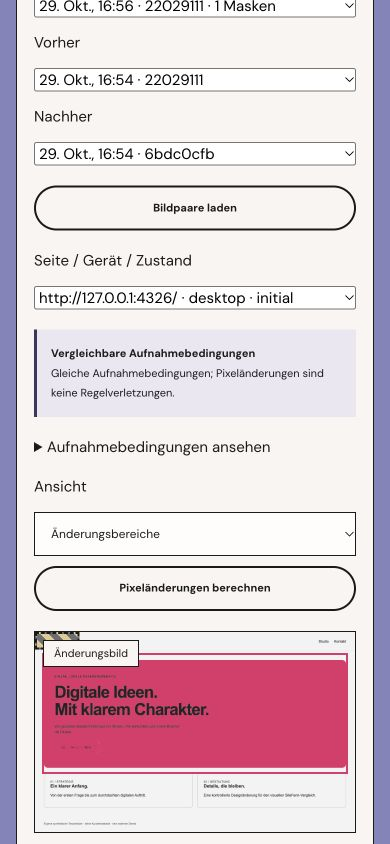

# SiteFenn 1.3 verification

2026-10-29. Local macOS Apple M5 Pro, 24 GiB RAM. The release adds visual references/comparison and server-scoped task retests. This record describes actual implementation tests, not an independent effectiveness study.

## Checks

- `npm run check`: passed.
- `npm test`: 78/78 passed, including real Chromium/Lighthouse fixtures and the new PNG/retest integration cases.
- `npm run build`: passed.
- `npm run test:e2e`: 12/12 passed. New UI cases cover wipe control, explicit mask editing, reference approval, a task-started retest, source navigation and mobile overflow. Those UI cases use controlled API fixtures; the separate integration below uses real worker/browser/API/image files.
- `npm run test:readiness -- .local-data/readiness-1.3-final`: passed. Existing real service lifecycle and local OAuth protocol checks; no native packaging or Google authorization is implied.
- `npm audit --audit-level=high`: zero reported vulnerabilities at test time.

CI covers macOS and Ubuntu; see the [workflow runs](https://github.com/mxweir/sitefenn/actions/workflows/ci.yml). Local results and remote-runner availability are separate. The published release notes record the available CI status.

## Actual end-to-end retest

A Node integration starts an explicitly authorized loopback fixture with two pages, a real Fastify API and the actual isolated browser worker. It captures a full mobile report with a missing title on the first page and a missing description on the second page. The fixture then adds the title and changes a visible background.

The task-retest endpoint derives a new one-page/mobile scan from the title task. The explicit matching title pass resolves that task. The omitted page's description remains **not retested**, the comparison emits no project-score delta, and the full-plan default remains separate. A subsequent full check does not overwrite the task's original verification scan ID. Cancelled runs and changed final document destinations cannot claim a fix.

The same test approves a full-scan reference, rejects approval without confirmation and rejects using a partial run as the project reference. It compares actual PNG captures, tests a rectangular mask, and checks that browser changes, missing historical capture conditions, font-readiness failure and changed scroll coordinates prevent a numeric pixel comparison. Portable backup/restore preserves the reference/mask record and the partial scan's source metadata.

A pure image case changes one pixel, checks the exact numerator/denominator, then excludes that pixel explicitly. Entirely masked images, mismatched dimensions and invalid PNGs are refused. These narrow fixtures are regression evidence, not general visual-accuracy percentages.

## Actual application review and captures

The built application was exercised separately against our owned **Orbit Studio** local fixture. Two pages and desktop/mobile profiles were captured before a controlled design/title change; a targeted title retest and another full scan followed. A reference and a 200 × 80 px mask were saved through the UI and reloaded after restart.

One actual desktop image comparison reported **624,442 changed / 1,280,000 compared pixels**, with **16,000 masked pixels** (48.78% after rounding), at channel tolerance 24/255. This is a controlled large background/button change, not a measured defect rate. No customer site or screenshot was published.

The browser review covered side-by-side images, keyboard control of the wipe slider, changed-region display, saved masks, reference confirmation and the separate partial-scope report. At a 390 px viewport, document width was 390 px. This is not a complete screenreader or real-device audit.

Actual 390 px comparison workspace

## Algorithm and limits

- Fixed local per-channel comparison, tolerance 24/255, including alpha. No perceptual model, AI vision, DOM defect classification or semantic quality score.
- Changed 32 px tiles are merged into at most 50 displayed region boxes. Pixel counting still covers the entire unmasked image. Tiny anti-aliasing changes can still be detected or suppressed by the tolerance; no general noise/error guarantee is made.
- PNG input: at most 20 MiB, 4,096 px per axis and 12 million pixels. One pair is processed at a time while heavy scans/analyses are idle. Original images are not modified; difference images are generated on demand.
- At most 30 explicit masks and 50 immutable reference approvals per project. A fully masked image has no assessable result. Masks are tied to the exact reference capture/page/device/state, not automatically relocated selectors.
- Captures record CSS/screenshot animation suppression, reduced motion, light color scheme, locale/timezone, `document.fonts` loaded status and the final URL. Browser/engine/platform/runtime/profile identity and scroll coordinates must match. This does not freeze arbitrary JavaScript, video, canvas or every delayed resource. Dynamic regions need review/masking.
- Missing conditions on older images remain unknown. Old captures can be viewed side by side; numeric assessment is refused when conditions are unknown or incompatible.
- Retests run the affected pages/profiles using the existing bounded initial/scroll sampler. They do not explore authenticated or interactive states. A changed document height may prevent an old scroll coordinate from being resampled; that finding remains unverified. A partial run is never a full-project score replacement.
- No new local-model claim is made. The [1.2 small-model limitations](RELEASE-1.2.md) remain applicable. Independent moderated UX validation, held-out visual evaluation, Windows/native installation and real Google OAuth remain open.

## Existing data

The data directory and database schema version remain unchanged. An additive `visual_references` table stores immutable approval records and is included in SQLite backups. Existing reports/tasks remain readable; no historical capture conditions or identities are invented. New rule identity is `rules-1.3.0`, so incompatible historical comparisons remain restricted. Source IDs and partial scope are included in report exports.
