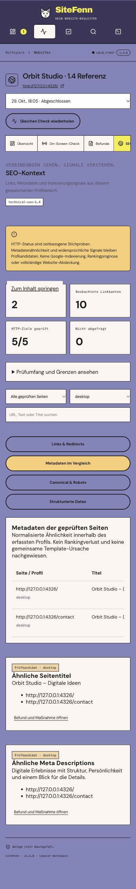

# SiteFenn 1.4 verification

2026-10-29. Local macOS Apple M5 Pro, 24 GiB RAM. This release adds bounded technical SEO context to the existing evidence → action → retest workflow. These are implementation/regression checks, not an independent SEO effectiveness or usability study.

## Checks

- `npm run check`: passed.
- `npm test`: 86/86 passed. Eight new cases include actual HTTP, gzip/XML, Chromium, worker/API, exports and a corrected-link retest. The full suite was rerun after the final selected-export and metadata-budget changes.
- `npm run build`: passed.
- `npm run test:e2e`: 14/14 passed. Two new UI cases use controlled API fixtures for deliberate sitemap selection and all four SEO areas, including a 390 px overflow check. Separate Node integrations exercise actual requests and workers.
- `npm run test:readiness -- .local-data/readiness-1.4-final`: passed; actual service lifecycle/restart/cancel/resume and local OAuth protocol contract. Native packaging and real Google authorization remain untested.
- `npm audit --audit-level=high`: zero reported vulnerabilities at test time.

[CI runs on macOS and Ubuntu](https://github.com/mxweir/sitefenn/actions/workflows/ci.yml). Published release notes record the remote CI status available at publication.

## Positive, negative and unknown cases

An owned loopback HTTP fixture and real Chromium captures exercise:

- A namespace-qualified sitemap and sitemap index, gzip child, duplicate URLs/index cycle, foreign origin, excluded paths, credential query, obvious mutating path, malformed XML, DTD/entity declaration, excessive nesting and decompression limit. An unsafe redirect to an unapproved private service is refused before contact; request logs assert the excluded/action endpoints were not contacted.
- Same-profile duplicate titles/descriptions across distinct captured documents. One captured document alone yields insufficient comparison scope rather than a duplicate-free claim. Redirect aliases resolving to the same document are not independent duplicates.
- A linked HTTP 404 (measured), a two-hop redirect (review candidate), HTTP 403 (restricted/unknown), a timeout, a redirect loop and missing/excluded target scope. Unknowns do not become confirmed bad links or a full passing link check.
- Generic and Googlebot-specific noindex, another bot's noindex, production robots/noindex context, staging intent, reachable canonical targets and canonical target noindex. Raw HTML target metadata is distinct from browser-rendered selected-page metadata.
- Valid JSON with an invalid supported Breadcrumb field, a valid supported inline profile, another schema type, unhandled context/reference and malformed JSON. Syntax success does not imply profile validity. Unsupported representations remain unassessed.
- Captures with 101 anchors and 21 JSON-LD blocks. Explicit truncation prevents claiming complete link/JSON coverage. Metadata and capture budgets remain recorded.
- Portable exports with queries/fragments omitted in structured URLs, selected SEO snapshot/edge scope, and separate SEO-context/checklist headings. Page-analysis units include the saved SEO records, subject to the existing explicit context budgets.

A real Fastify API plus isolated browser worker creates an HTTP-link task, then the fixture fixes the 404 and removes previously unknown/excluded link scope. The task-retest endpoint inherits SEO mode, obtains a matching measured pass and verifies that requested task against the new scan. A test does not force a pass while restricted/excluded targets remain unknown.

## Actual application review and screenshots

The built app ran in a separate local data directory against our owned **Orbit Studio** fixture. Two URLs × desktop/mobile produced four completed views, ten observed directed link edges and five checked target URLs. The graph displayed the controlled 404 and two-hop redirect; opening the 404 action navigated to the exact measured finding, original screenshot and acceptance criterion.

The metadata view showed same-title/description candidate groups. The Canonical/Robots area showed the received robots.txt restriction and a noindex canonical target. The structured-data area kept a valid JSON parse separate from the deliberately invalid Breadcrumb position. Because the UI project was explicitly local, it did not impose production-only own-noindex assumptions. Production conflict behavior is covered by the controlled integration above.

The actual sitemap import returned three candidates; the two newly added candidates remained unchecked and no scan started. Desktop width was 1,440 px and document width 1,440 px. Mobile width/document width were both 390 px in link and metadata views. Tables have their own keyboard-focusable scroll container. This is not a full screenreader or real-device audit.

Only owned synthetic material is pictured. No customer reports/screenshots are published.

Actual sitemap import and mobile layout

## Scope and budgets

### Sitemap import

- Same approved origin, existing network/local-origin policy and excluded paths, including redirect destinations. DNS is resolved/checked and the approved IP pinned for each HTTP hop. No arbitrary private-network access or hub API access is granted.
- XML `urlset`/`sitemapindex` in the standard sitemap namespace; absolute HTTP(S) locations. XML/gzip only, not HTML/TXT/RSS sitemap inference. DTDs and external entities are rejected.
- At most five documents, two index descents, 500 stored locations per document, 20 HTTP attempts including hops, 30 seconds total and five seconds per request. Each response is capped at 1 MiB decoded and twice that on the wire; final XML document bodies share a 4 MiB budget. Redirect bodies also have individual caps; they are not counted as final XML documents.
- The chosen candidate limit is at most 30. New candidates remain unchecked in the explicit import flow. Existing automatic discovery may also use bounded sitemap candidates within its chosen scope. Neither proves a full index.

### SEO context requests and captures

- Optional `technicalSeo` scan option, on by default in the new manual scan UI; omission in legacy/API scan options does not silently add it. Repeated/scoped runs retain the original option. Previous reports do not gain invented data.
- Up to 40 unique target URLs, 60 HTTP request attempts including robots/redirects, five redirects per read, 90 seconds total and five seconds per request. Final sampled bodies share 8 MiB; an individual body is capped at 256 KiB, robots.txt at 32 KiB. Wire/decoded limits apply per hop as well. A restricted/failed/deferred request remains unknown.
- Unauthenticated GET with no imported cookies. Target HTML is parsed without script execution; selected-page browser captures remain the existing separate process. HTTP status is retained even when raw metadata parsing exceeds its budget.
- At most 100 recorded anchors per page/profile and 1,500 graph edges. Repeated edges carry observed profile IDs. Duplicate comparison normalizes case/Unicode/whitespace within a profile and compares captured final documents, not all domain pages.
- Metadata, canonical and JSON-LD collection are capped. Up to 20 JSON-LD blocks, 100 KB per block, 1,000 traversed JSON nodes and 100 elements per supported breadcrumb list. Over-budget or unsupported portions cannot establish a complete pass.
- The supported structured-data check is only an inline schema.org `BreadcrumbList` subset: list shape, at least two inline ListItems, positive unique positions, name, and target field except the final item. Unresolved references, context aliases, relative target representations and other schema types are outside the evaluated subset. No remote contexts are fetched, no comprehensive Schema.org validation or Google eligibility is claimed.

Conservative assessment can leave a rule unknown even when an observed subset looks healthy. HTTP 404 is a timestamped response, not proof of permanent failure. HTTP 401/403/405/429 remain restricted rather than confirmed dead links. Redirect chains, duplicate metadata, breadcrumb field issues and intent-dependent canonical/robots conflicts remain review candidates. A common template cause is never assumed from grouping.

## Interpretation and primary references

- [Sitemap protocol](https://www.sitemaps.org/protocol.html): supported XML vocabulary and absolute locations. SiteFenn deliberately uses much smaller local budgets than the protocol maximum.
- [Google robots.txt introduction](https://developers.google.com/search/docs/crawling-indexing/robots/intro) and [noindex guidance](https://developers.google.com/search/docs/crawling-indexing/block-indexing): robots is not access control or indexing proof; crawl blocking can prevent seeing noindex.
- [Canonicalization](https://developers.google.com/search/docs/crawling-indexing/canonicalization) and [consolidating duplicate URLs](https://developers.google.com/search/docs/crawling-indexing/consolidate-duplicate-urls): signals require context; SiteFenn does not observe Google's selected canonical or infer a duplicate-content ranking penalty.
- [Google Breadcrumb profile](https://developers.google.com/search/docs/appearance/structured-data/breadcrumb): basis for the explicitly limited subset, not a replacement for Google's validation or a rich-result guarantee.

No orphan-page proof, Google indexing verification, live ranking prediction or complete crawler is introduced. No new local-model quality claim is made; [1.2 limitations](RELEASE-1.2.md) remain. Independent labeled/held-out evaluation, moderated UX testing, Windows/native distribution, real Google OAuth and authorized interactive journeys remain open.

## Data and exports

No database schema migration is required. New reports have optional `seo` snapshots/probes/graph/groups and parser provenance; existing reports stay historical. The legacy data path remains unchanged. Rules use `rules-1.4.0`, context `technical-seo-1.4`; engine identity includes the new services and parser versions. Incompatible historical comparisons remain restricted.

JSON contains the full observed graph for a full report; Markdown lists at most 100 edges with an explicit limit notice. Selected-finding exports limit SEO snapshots/edges to the selected pages/profiles; related target and duplicate-group URLs remain context. Coverage counters always describe the original scan. Structured URLs omit credentials/query/fragment; arbitrary text can still contain private content and must be reviewed before sharing. Screenshots remain opt-in exports. No raw JSON-LD script bodies are persisted in SEO context.
