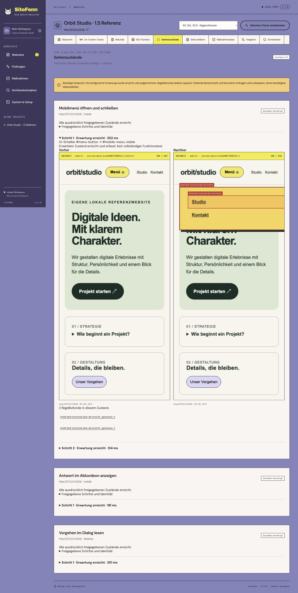
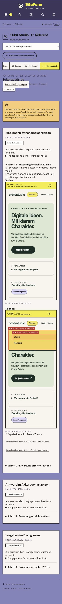

# SiteFenn 1.5 verification

2026-10-30. Local macOS Apple M5 Pro, 24 GiB RAM. This release implements explicitly approved page states: a fresh start page, declared native UI switches/scrolls and expected results. It does not introduce autonomous exploration or authenticated journeys.

## Checks

- `npm run check`: passed.
- `npm test`: 91/91 passed. Five new cases include real Chromium, the actual worker/Fastify API, real image files, changed-state comparisons, interrupted reuse and deadline closure.
- `npm run build`: passed.
- `npm run test:e2e`: 16/16 passed. New controlled UI cases cover recipe preview, approval revocation, submitted configuration, unknown outcomes, evidence pairs and mobile width. Separate worker integrations exercise real actions and requests.
- `npm run test:readiness -- .local-data/readiness-1.5-final`: passed. Existing actual service lifecycle and local OAuth protocol contract; no native packaging or real Google authorization is implied.
- `npm audit --audit-level=high`: zero reported vulnerabilities at test time.

[macOS/Ubuntu CI](https://github.com/mxweir/sitefenn/actions/workflows/ci.yml) is separate from local results. Published release notes record the remote outcome for the release commit.

## Real integration cases

An owned loopback fixture has a menu that only overflows when open, a native details accordion, a native dialog and deliberately forbidden handlers.

1. The real API/worker captures a mobile base page and five expected states: menu open/closed, accordion open, a 600 px scroll with the accordion still open, and dialog open. The base/closed layout passes while the open-menu overflow fails. Before/after PNGs, rule evidence and state records are persisted. Base page/device coverage stays 1/1; state coverage is separate.
2. The fixture fixes the menu width. A task retest repeats only the menu recipe, reaches the same state identity and obtains a matching layout pass. The requested task is verified. Other recipes are omitted, and no full-project score delta is produced.
3. Marking that resulting state unknown prevents a resolved comparison. Unconfirmed capture metadata prevents a numeric visual diff. An actual new run with a changed recipe definition cannot reuse the old state's numeric comparison or claim its fix.
4. An unfinished persisted recipe is supplied as interrupted resume input. The base/recipe are executed again, new evidence IDs are written and base coverage remains correct. Already terminal compatible records may be retained; unfinished state traces are not treated as a completed page.
5. A button in a form, a missing selector and a button attempting POST leave the attempted state unknown, keep future steps unexecuted and leave their seeded rules `not_run`. The fixture receives no mutation request.
6. Real handlers attempting document navigation, an obvious mutating GET path and a same-document `history.pushState` URL change stop with unknown results. The new-document/mutating endpoints are not contacted. No changed URL is accepted as the declared resulting state.
7. A real Chromium context runs with an internal shortened 150 ms test deadline while an operation is waiting. The context closes, the step stays unknown and no successful state is reported. The production deadline is fixed at 30 seconds and is not user-overridable through scan configuration.

The portable report checks verify default omission of evidence IDs/artifacts, explicit inclusion of the relevant finding's before/after evidence when requested, and the approved-state Markdown section. Page-analysis context includes structured trace units with explicit unknown/outcome semantics. Model quality was not reevaluated and no new model claim is made.

## Actual application review

The production build ran separately in an isolated local data directory against our owned **Orbit Studio** fixture. One page × desktop/mobile produced two completed base views and four confirmed states across three recipes: mobile menu open/closed, mobile accordion open and desktop dialog open.

The deliberately overwide opened menu produced measured findings with overlays; the closed state remained separate. After the fixture width changed, a real task retest ran only the mobile menu recipe, confirmed both expected states and verified the source task. Its open state showed zero rule findings. The UI continued to label it as a partial run.

The editor preview showed the exact configured action/target/expectation. Editing its name revoked approval and disabled starting until approval was given again. Desktop review used 1,440 × 1,000 px; at 390 × 844 px the editor and expanded state evidence report both had a 390 px document width. This is a browser review, not moderated user validation or a complete assistive-technology audit.

Only owned synthetic content is published in these screenshots.

Actual editor, mobile state report and corrected-state retest

## Supported scope and limits

- At most three approved recipes per scan, five steps per recipe and 18 total step/device combinations. Each recipe uses a selected start URL and a subset of the scan's selected standard device profiles. Unapproved configurations, extra fields, arbitrary scripts and unsupported action kinds are rejected.
- A fresh browser context per recipe/device starts at that explicit URL with the existing network policy, no imported authentication/storage and no service workers. This is the navigation step; arbitrary intermediate navigations or link clicks are not supported. Subsequent document navigations and URL changes, including same-document SPA changes, invalidate the recipe.
- Start navigation: up to ten seconds plus bounded initial stabilization. Execution: a shared 30-second context-closing deadline across the recipe's steps; time spent paused at a checkpoint is excluded. Lookup/action/expectation waits are separately bounded. Screenshots use the existing eight-second bound and axe has a six-second result deadline. Operations may end early; a failed capture does not invent an image.
- The scan worker additionally applies an overall paused-aware deadline: at least two minutes, at most 30 minutes, based on base views, configured recipe/device instances, optional SEO and performance work. It can terminate the isolated worker if ordinary operation limits fail. This does not establish operating-system isolation from malicious browser content.
- Selectors are unique simple IDs or single exact `data-testid`/`aria-label` attributes. Ambiguous/missing nodes stop. Native active `button type="button"` controls must refer to the expected target through `aria-controls` and declare disclosure/dialog semantics. Native `summary` must control its own `details` with an open/closed expectation. Forms, links and nested interactive contents are rejected; recognizable destructive/transactional/authentication labels/paths are refused.
- Click expectations must change from the pre-action result. Readiness is checked before auditing the resulting state. Visible/hidden means rendered CSS visibility, not proof of usability or complete on-screen reachability. Scroll actions require the requested Y coordinate to be reached within 2 px; out-of-range positions stop rather than being silently clamped and accepted.
- During actions, additional routing blocks methods other than GET/HEAD, document navigation, foreign-origin requests and recognizable mutating GET paths/credential query keys. Any observed policy block leaves the state unknown. This can deliberately prevent data-driven widgets from working; it does not prove those widgets are defective.
- Layout and automated axe checks run on each confirmed resulting state. Before images are context, not another passing rule budget. SEO/runtime base checks and Lighthouse retain their existing scope; they are not automatically repeated as complete functional tests for each state.
- Every configured state has seeded rule instances before execution. Missing, skipped or unconfirmed states remain unknown, including if a screenshot exists. The observed state count is separate from base page/device coverage. Different configured states change comparison scope; more states are not proof of a universally better score.

The [Playwright locator contract](https://playwright.dev/docs/api/class-locator) underlies unique-node actions and bounded waits; [native button semantics](https://developer.mozilla.org/en-US/docs/Web/HTML/Reference/Elements/button) and [disclosure controls](https://developer.chrome.com/docs/modern-web-guidance/guides/html/html) inform the deliberately limited control support. These checks do not prove a website handler is harmless. Trusted, authorized targets remain required: JavaScript can have side effects even behind an innocuous control or GET request. No orders, payment, form submission, login, arbitrary code execution or AI-driven clicking is offered.

## State identity, data and exports

The optional `journeys` scan option stores the approved definition. `journeyRuns` stores per-recipe/device outcomes and per-step before/after IDs, durations and details. State IDs include a hash of the recipe definition, excluding the device list so a scoped device retest can reproduce the same identity. Changed definitions generate new states. Evidence records mark whether the state was confirmed; unconfirmed evidence is not eligible for numeric visual comparison.

Retests inherit only recipes referenced by the task's state findings. A matching completed state, same execution identity, final document, capture position and explicit passing rule are required for verification. Omitted/unknown states cannot resolve a task. Full comparison also requires the same options/scope. Existing visual-reference approval rejects failed page/state records.

Markdown/JSON include structured trace context. Selected-finding exports restrict it to the selected pages/profiles. Screenshots remain opt-in; for an exported state finding, the related before/after images can be included with allowlisted archive paths. Default exports omit evidence IDs/paths. Arbitrary page-derived text/images can remain confidential and must be reviewed before sharing.

No database schema migration or data-directory change is needed. Existing reports stay historical; absent interaction state is not fabricated. New rules use `rules-1.5.0`; the new services and shared recipe semantics participate in engine provenance. The mobile overflow correction is covered by the actual open/closed fixture, not presented as general detection accuracy.

Independent held-out accuracy work, moderated UX testing, full screenreader review, Windows/native packaging, real Google OAuth and reliable local-model evaluation remain open. The [1.2 model limitations](RELEASE-1.2.md) still apply.
