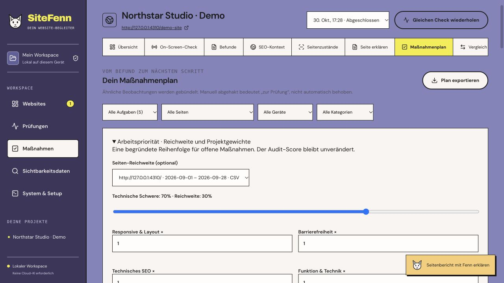

# SiteFenn 1.7 verification

2026-10-30. Stable local web workflow plus an **experimental Google connector**; a real Google account authorization/import/revocation has not been performed. CSV remains independent and supported.

## Delivered

- The actions workspace includes an explicit work-priority view. Default points are measured severity × 70% plus observed page reach × 30%, multiplied by a project category weight (0.5–2). These are relative ordering points, not a 0–100 quality score. Weights persist per project in an additive preferences table; the database schema version and old data path remain unchanged.
- Choose a page-dimension dataset explicitly. Exact observed page URLs match rows; duplicated devices do not multiply impressions. The largest observed page count is used per grouped task, avoiding addition of potentially overlapping aggregates. Missing rows remain unknown and points provisional; no fabricated reach bonus. Heuristics do not gain measured severity points. Verified/accepted tasks are excluded from this ordering.
- At least 100 observed impressions and calculated CTR below 2% produce a bounded investigation list. Thresholds are heuristics, not forecasts or evidence of a technical cause. Audit findings, acceptance criteria and scores are unchanged.
- Optional direct Search Console import uses a user-owned Google Cloud **Desktop** OAuth client, PKCE S256, random one-use state, an ephemeral IPv4-loopback callback, five-minute expiry and only `webmasters.readonly`. Configuration and refresh token are isolated by data-directory identity in the macOS Keychain, never SQLite/portable backup/exports. No plaintext fallback. The optional native binding is disabled on other platforms until tested; CSV still works there.
- The user explicitly enables storage/connection, opens Google's consent page, chooses property/dates/dimension/filter and requests an import. Revocation must succeed at Google before the local secret is removed, and local deletion is read back. Failed revocation retains the connection for retry rather than claiming success.
- Google API requests use fixed HTTPS endpoints, redirects disabled, 15-second timeout and 8 MiB response limit. Imports retain web/final query metadata, date/property/filter context and a 25,000-top-row cap. Missing/anonymized rows are not fabricated; returned rows are not complete property totals. Average position stays historical/aggregated.

## Actual checks

- 115/115 Node tests; type checks and production build passed.
- 17/17 browser tests passed. The new priority UI was additionally exercised against the real service and owned demo; selecting a synthetic CSV source recalculated the displayed ordering and persisted weights. Screenshots contain **owned synthetic metrics, not real Google measurements**.
- Controlled OAuth protocol test actually uses a loopback listener and checks wrong-state rejection, S256 verifier, read-only scope, refresh request, scoped import, failed revoke retention and confirmed revoke deletion. HTTP Google responses and vault are injected fixtures in this test. This does not validate Google's live account/consent behavior.
- A separate actual macOS Keychain round trip stored/read/deleted a unique synthetic value and confirmed its removal. No real Google token was used. `@napi-rs/keyring` is an optional dependency, separately MIT licensed; its availability is not a cross-platform guarantee.
- Dependency audit reported no vulnerabilities at installation. Hosted release CI is linked in the GitHub release; queued jobs are not counted as passed.

## Setup and remaining work

Create a Desktop OAuth client in your own Google Cloud project, enable Search Console API, configure consent/test users as required, then choose its downloaded JSON in **Sichtbarkeit → Google direkt verbinden**. Do not commit that file. The file is normalized to the needed client fields and stored in Keychain after explicit opt-in. Authorize in Google's browser page, refresh connection status, set the query scope in the import form and request the import. The UI deliberately calls the connector experimental until an authorized real-account retrieval and revocation is checked.

Live Google verification, API approval/quota requirements, other-OS credential stores, CrUX, per-page click-decline candidates and automatic scheduled Google sync are not shipped as validated features. No SERP scraping, universal live ranking, causal SEO attribution or model-quality improvement is claimed.

[Google Desktop OAuth](https://developers.google.com/identity/protocols/oauth2/native-app), [Search Analytics query limits](https://developers.google.com/webmaster-tools/v1/searchanalytics/query), [read-only property listing](https://developers.google.com/webmaster-tools/v1/sites/list), [native keyring binding](https://github.com/Brooooooklyn/keyring-node).

