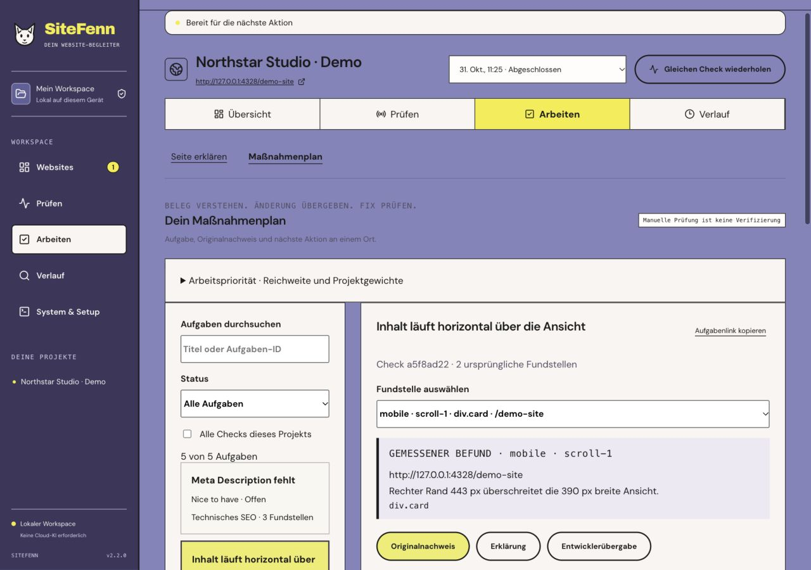

# SiteFenn 2.2 — keep the fix in context

Release scope: local Web/CLI, 31 October 2026. This implements the 2.2 workspace step from [the 3.0 plan](../PLAN-3.0.md). The measurement and verification safeguards from 2.1 remain active.

## A connected repair workspace

Four primary project sections — **Übersicht, Prüfen, Arbeiten, Verlauf** — replace the flat nine-item navigation. Report/SEO/approved states, explanation, comparison and visibility remain contextual views. In **Arbeiten**, a project-scoped task list opens the selected observation beside its original measurement and screenshot. The observation picker preserves URL, device, state and selector; tasks with the same title are distinguished by their actual source location.

Status/review, the recorded acceptance criterion, targeted retest and plan export are available beside the selected task. **Erklärung** embeds the existing optional page analysis; **Entwicklerübergabe** embeds a selected-finding Markdown work package. Source access still requires deliberate consent and a fresh preview; changing the observation, leaving/reopening the pane or reloading does not silently restore a source root, preview or authorization. No automatic source edits, commits or deployments.

Project/check/task/finding/pane state is represented in local URLs. Reload, copied links, Back/Forward and the return from a targeted retest keep the work context. Historical checks outside the startup response load directly by ID. Missing/archived projects, checks or tasks offer an explicit recovery path instead of silently displaying a different check. These links refer to IDs in the same local workspace; they are not public cloud share links.

Uncritical report/history/work filters, scan configuration defaults and local work notes persist per project in this browser. Notes are task-specific, do not count as repair evidence, and are not exported. URLs selected for a new scan, approved journeys, source roots, consent, credentials and model responses are not restored as configuration permissions. Clearing browser storage clears these UI drafts/notes, not the SQLite workspace.

Fenn now has a reserved area in the document flow. The new work view uses readable text, progressive details, a bounded scrollable original capture and a responsive task/detail layout. The shared readiness contract disables expensive retests/analysis/source actions while cleanup or another exclusive operation still owns resources; reading saved evidence remains available.

## Complete history without loading every report

Startup uses cached scan summaries, latest full/most-recent and active heads for every project, complete project counters and no global task-list payload. SQL queries do not fetch full report JSON and then strip it in JavaScript. An old quiet project remains represented even after another project has accumulated more than 300 checks. A full report is fetched for the chosen work/report context; exports and source/retest safeguards continue to use the persisted original report.

Project check/task endpoints provide bounded cursor pages (default 50, maximum 100), search, status and check scope. Cursors are bound to project, query, scope and endpoint. Newer records inserted while paging do not produce duplicates in the older pages; refresh to include newly added heads. The history and task views expose load-more controls and visible totals. Comparison choices can load older pages as well. Per-check original reports remain complete; selected report detail/export may legitimately contain all of that check's observations/tasks.

A new nullable `scans.summary` column and project task index are additive under database schema version 2. Existing reports are backfilled once using an iterator inside a transaction; source reports remain unchanged. Checkpoint/finish write report and summary together, and restoring a trash entry regenerates its summary. Back up before updating; the workspace path stays the same.

Measurement identities stay `rules-2.1.0`, `report-contract-2.1`, `audit-score-v2.1` and `release-gate-2.1`; this is a workflow release. Existing strict execution compatibility still includes the application version, so a 2.1 baseline does not become automatically comparable with 2.2. Compatibility policy changes remain planned for 2.4.

## Verification and measurements

- **146 Node tests**, including 1,000 synthetic checks / 10,000 tasks fully enumerated without duplicate IDs, old-project startup coverage, filter/cursor rejection, cache backfill preservation and trash restore. The bootstrap test refuses the old full-report listing method.
- **27 browser tests**: reload/Back/Forward, exact observation context, older deep links, missing-target recovery, project-specific drafts, source-consent reset, pagination/search, readiness gating and the existing actual Chromium/CLI/repair/backup workflows.
- Layout checks at **320 / 390 / 768 / 1280 CSS pixels**, including desktop column usability and a **200%-equivalent reflow profile** (640 CSS pixels representing a 1280-pixel viewport at 2×). This is controlled Chromium emulation, not a complete native browser-zoom, screenreader or accessibility certification.
- Actual UI/service demo: full check → mobile `scroll-1` observation → targeted retest → return to the same original observation → selected-finding Markdown preview. The unchanged demo overflow correctly remains **Offen**; no repair was claimed. No external/customer sites or new model inference were used for this release.
- Types/build, service lifecycle/restore, the existing 23-case AI output guard corpus and portable extraction/setup/start/restart/persistence are part of release verification. The exact remote CI outcome is recorded on the GitHub release.

[Public synthetic query benchmark](evaluation/workspace-scale-2.2.json), macOS arm64 / Node 24.19.0, 30 measured samples after five warmups:

| Controlled operation | p50 | p95 | Serialized result |
| --- | ---: | ---: | ---: |
| Project heads + complete counters | 6.64 ms | 7.19 ms | 1,048 bytes |
| 50 check summaries | 3.08 ms | 3.36 ms | 31,791 bytes |
| 50 tasks | 0.16 ms | 0.18 ms | 20,193 bytes |

One-time summary backfill: **41.48 ms**. Maximum process RSS sampled after these calls: **114.81 MiB**. This fixture has 1,000 checks, 10,000 tasks and one additional old-project check, with 16 KiB of synthetic full-report detail per check. These are local SQLite/query-plus-JSON observations, **not HTTP/browser end-to-end latency, whole-system/peak memory or representative complex real reports**. Reproduce with `npm run benchmark:workspace -- NEW_OUTPUT_DIRECTORY`; generated private workspaces are removed, the public summary contains no user paths or credentials.

## Actual application screenshots

Owned local demo, actual saved evidence and unchanged open task; no model output or score was fabricated for these screenshots.

Navigation, inline work package and mobile observation

## Still open

Independent pilot/accessibility/screenreader testing, native browser-zoom acceptance, held-out human/model accuracy evaluation, real Google OAuth/property acceptance, real Windows and signed/native distribution. Model advice remains unverified. Semantic explanation/editor improvements remain 2.3; compatibility policy 2.4; full persisted resource/job scheduling and large streaming backups 2.5. UI notes are browser-local drafts, not multi-device synchronization.
