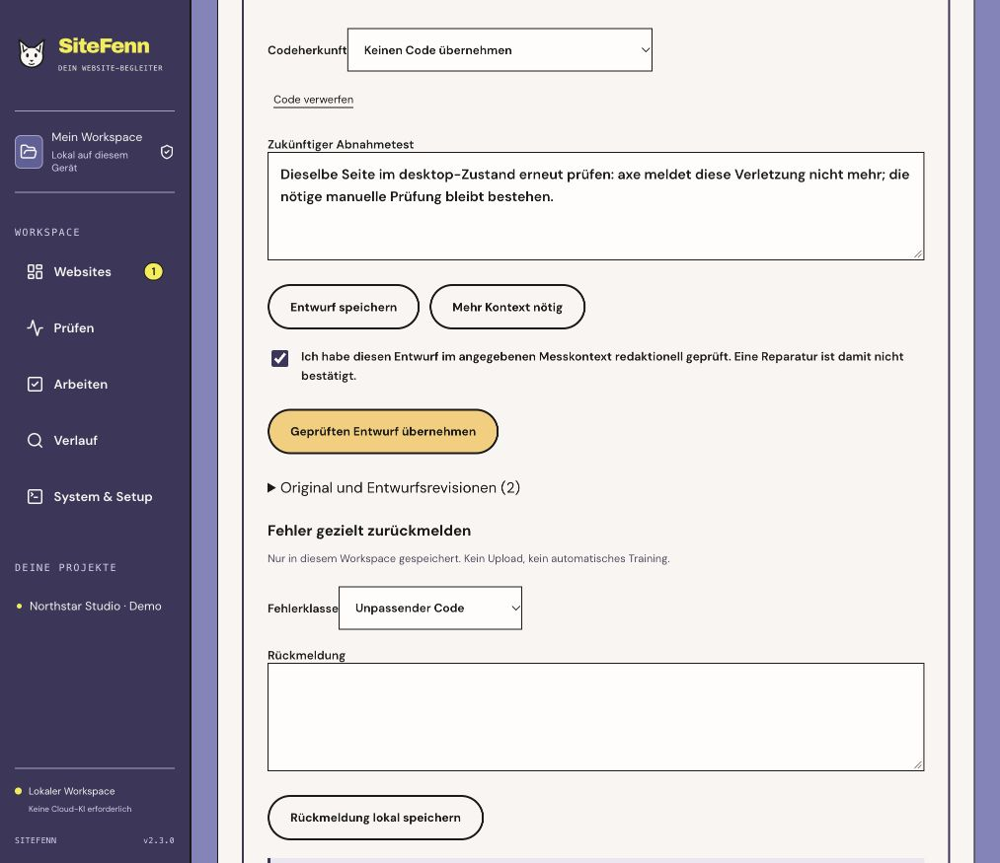

# SiteFenn 2.3 — measured facts, reviewed proposals

Release scope: local Web/CLI, 31 October 2026. Implements the explanation/review step in [the 3.0 plan](../PLAN-3.0.md). Optional model advice remains experimental.

## Facts do not depend on a model

The page explanation view now starts with a deterministic fact card, available without Ollama. Switch between the selected page and the complete check. It lists the recorded profiles and expected rule inventory by page, device and state, with individual rule IDs, statuses and finding references. Missing or contract-invalid measurements stay unknown. Counts and the summary come from the original report, never a model-written summary.

New analyses use `page-report-2.3.0`. Each finding carries its canonical observation, scope, selector and recorded viewport. Server-added references bind proposals back to that observation; a reference is not a correctness guarantee. The server substitutes the captured selector into the explicit `{{selector}}` code placeholder. Existing ID/class changes and invented selectors remain visible as issues; consciously new examples require an explicit origin and `sf-example-` IDs/classes.

The former synthesis over earlier model-written summaries has been removed. Follow-up questions keep the same report/context identity and previous question, but do not feed previous answers back as measurements. Deterministic facts stay identical when report arrays or model partitions are reordered. Historical raw/model summaries remain separately labelled history; saved evidence is not rewritten.

## Edit, discard, then deliberately adopt

Each completed finding proposal opens a review editor. Edit steps and the future acceptance test, discard unsuitable code, start again from the original rule recommendation, or save **Mehr Kontext nötig**. These revisions do not change the model answer. Causes, business impact and model explanations remain unverified hypotheses and are not copied into a reviewed task.

Adoption requires a saved approved revision and explicit confirmation. Any edit revokes the checkbox. Revisions bind the original answer and canonical observation with SHA-256 hashes, analysis/check/finding IDs, URL/device/state and exact selector. Changed originals, stale scope, unapproved/foreign revisions, invalid measurement contracts and known device/selector/numeric contradictions are refused. Narrow guards also catch specific unsupported code/actions; they are not a CSS compiler or a general semantic validator. Review is editorial judgement, not proof of a repair. Adoption updates the existing deterministic task and keeps it open; a later compatible measured retest remains the verification mechanism.

Code origin and review identity are retained with the task. Original responses, immutable revisions, local classified feedback and future scan verification remain distinct. Markdown export includes the deterministic whole-check rule matrix, original proposals, revision bindings and feedback. Unsubmitted editor fields are temporary; saving a revision persists it in this workspace.

Local feedback categories: factual contradiction, bad code, bad acceptance test and missing context. No automatic upload or training. Up to 500 immutable revisions and 500 feedback records per analysis; the limit is explicit. Feedback is input for later investigation, not a vote that changes the Audit-Score.

## Verification

- **152 Node tests**: stable facts, no model-summary chain, exact source bindings, known device/number/ID-class errors, URL/selector disambiguation, explicit example origin, discarded code, malformed CSS-length placeholders, stale/foreign/unconfirmed revisions, idempotent adoption and classified feedback validation.
- Review/feedback records survive actual SQLite restart, reversible trash and portable backup/restore, together with the original answer. Existing real Chromium repair, CLI, crash/recovery and report-contract tests remain passing.
- **31 browser tests**: editor changes revoke approval, code discard, needs-context without adoption, local feedback, reviewed adoption, and core editor/matrix controls at **320 / 390 / 768 / 1280 CSS pixels**. Existing source-consent reset, workspace links and equivalent reflow tests remain active. Controlled Chromium checks are not independent accessibility certification.
- Types, production build, existing **23-case** AI output guard corpus, service lifecycle/restore, local OAuth protocol contract and portable setup/start/restart/persistence are included in release checks. Exact remote CI is linked on the GitHub release.
- [Three-model internal comparison](EVALUATION-2.3.md): identical frozen synthetic inputs across installed 3B/4B/7B models, raw outputs, digests, budgets, guard results and duration. No model is promoted to a verified expert; structural acceptance, useful steps, factual errors and appropriate abstention are separate questions.

## Actual UI/service acceptance

The owned three-page demo was checked at desktop/tablet/mobile. The full report contains 13 findings, 80 passed rule instances, 10 failed, 6 unknown and 9 not applicable; its measurement contract is valid. The contact page contains 3 findings across the 3 devices. An actual selected `qwen2.5:7b` analysis processed **4/4 parts / 50 context records**, retaining its limitations and unsuitable example code as unverified proposals.

In the real UI, the desktop `input` proposal was opened, its invented-ID HTML code discarded, steps/acceptance edited, a needs-context revision saved and a **bad-code** feedback record stored. [Recorded acceptance summary](evaluation/ui-review-2.3.json). The implementation agent then explicitly confirmed a curated revision. The server attached it to the existing task with status **open** and the notice that no fix was confirmed. These are agent-operated acceptance steps, not independent human usability/semantic approval. The original model solution remains separately stored. Screenshots below show the actual saved result.

## Actual application screenshots

Owned local demo checked by the real browser service. The facts and statuses are stored measurements, not mocked results.

Actual reviewed draft, confirmation/feedback and mobile editor

## Update and remaining limits

Back up the existing workspace before updating. Two additive SQLite tables store immutable reviews and feedback under schema version 2; the existing workspace path remains unchanged. Old reports and proposals stay readable. Previously adopted unreviewed suggestions are labelled historical; any new adoption, including from an old analysis, requires the new review path. Review data is included in backups and reversible trash. Restore into a new directory, never overwrite a running workspace.

Rule/report/profile/score/gate identities remain `rules-2.1.0`, `report-contract-2.1`, `responsive-1.0.0`, `audit-score-v2.1` and `release-gate-2.1`. Existing strict execution compatibility still includes application/toolchain identity. 2.4 will address compatibility policy; no baseline is silently relabelled.

Independent pilot/accessibility/screenreader review, held-out human-labelled model evaluation, real Google property/OAuth acceptance, real Windows and signed native distribution remain open. The model comparison is a development regression study reviewed by the implementation agent. It is neither independent human approval nor evidence of general accuracy or SEO effectiveness. No new weights, fine-tuning or model qualification ships in 2.3.
