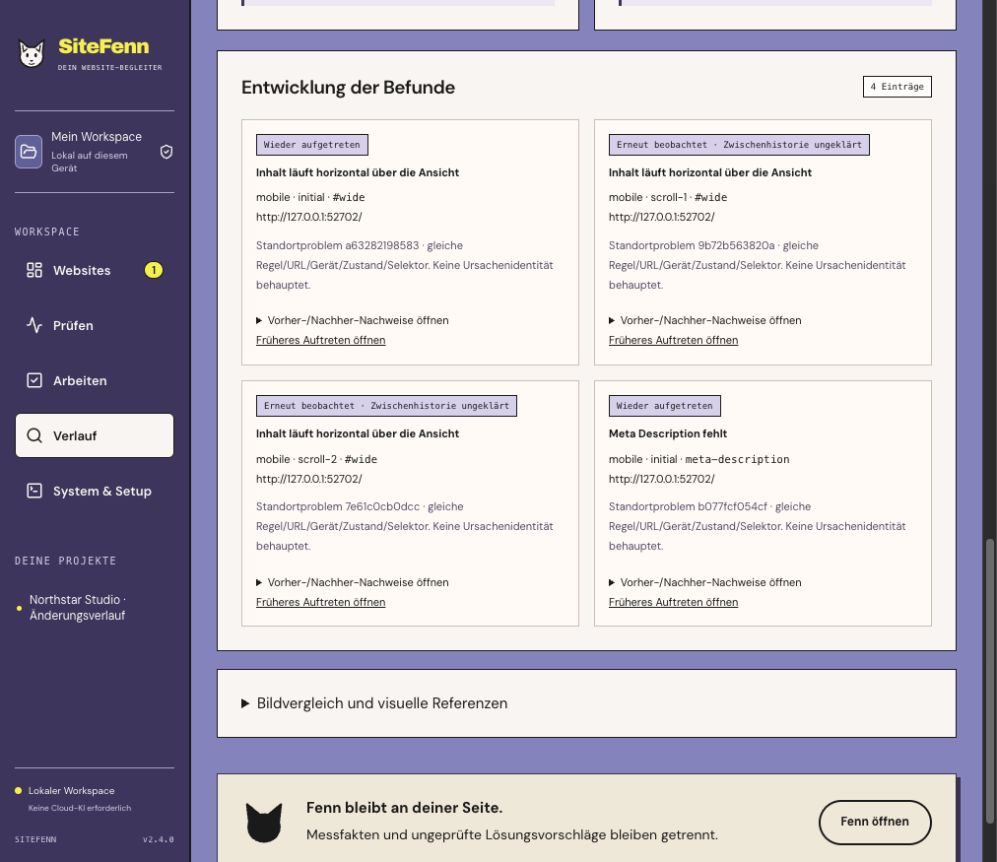
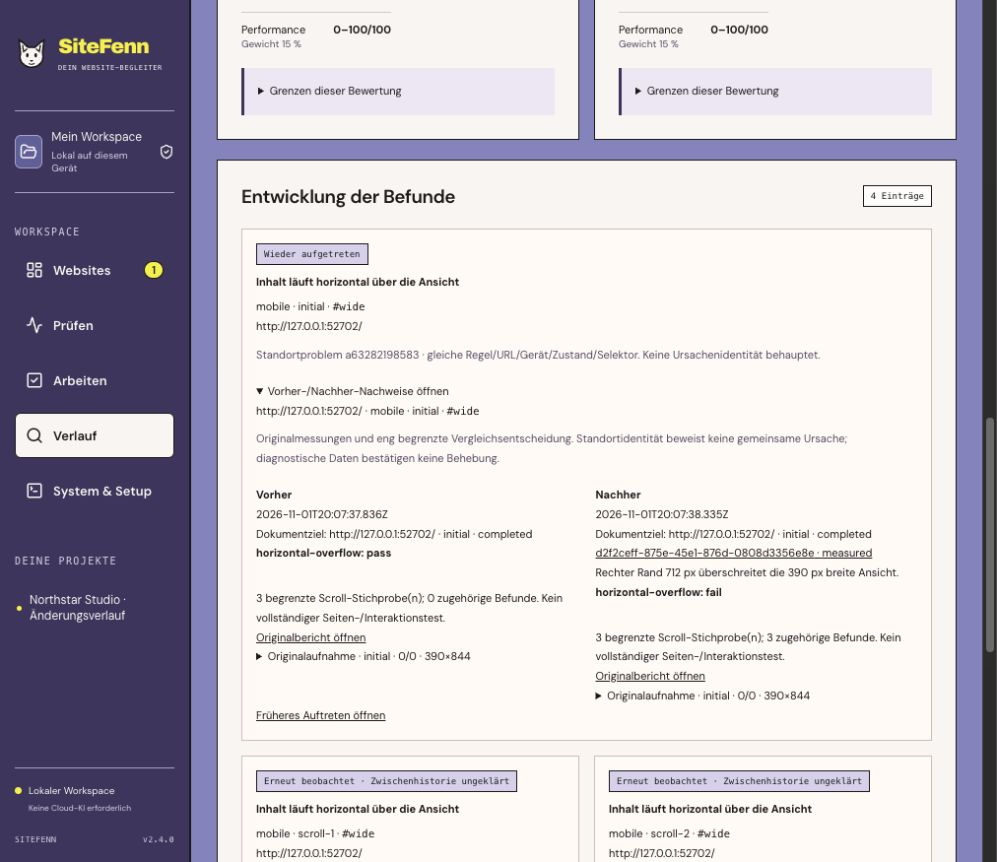
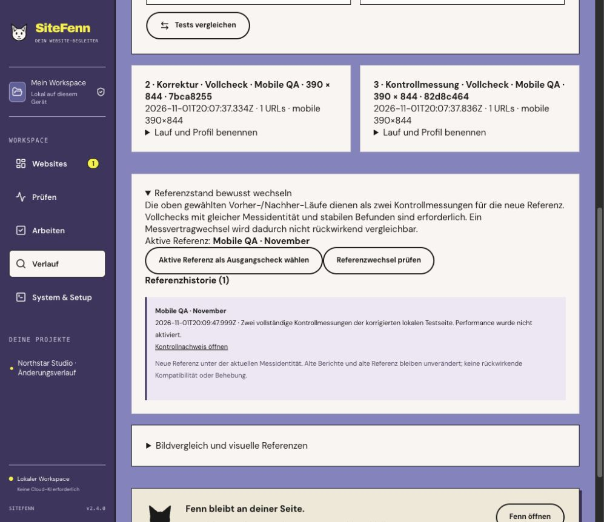
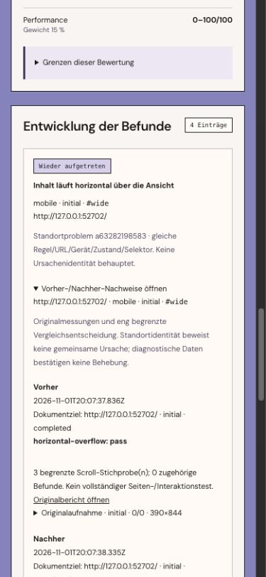

# SiteFenn 2.4 — understand what changed

Release scope: local Web/CLI, **1 November 2026**. Implements the change/history step in [the 3.0 plan](../PLAN-3.0.md).

## A useful change view

Checks now distinguish **new**, **persistent**, **verified resolved**, **recurrent**, **not retested**, **incompatible** and **uncertain mapping/history**. Each location exposes its rule, URL, device, state and selector. On-demand before/after details show the original finding, measured rule result, document target, numeric sample when relevant and original captures. Links return to the exact saved finding/report; a previous occurrence remains reachable from the history row.

A project-scoped persistent location identity is separate from random finding IDs and occurrence fingerprints. Repeated observations retain their location identity. A selector change or duplicate candidates requires review and does not silently become the same cause. Recurrence requires proof of an intervening compatible pass. Historical task-verification counters are explicitly labelled historical, rather than current project health.

The primary comparison comes first; visual comparison/reference tools remain available in progressive details. Run and profile names, exact timestamps, scope kind and selected profiles make similar checks easier to distinguish. Changing the selected pair clears the old result; pending comparison selectors are disabled so a late response cannot silently appear under a different pair.

## Three compatibility levels

New provenance separates application version from capture, normalization and verification identity. A frontend/application-version-only patch can keep exact comparison when every measurement identity and scope component is unchanged. Browser, toolchain or identity changes remain diagnostic; invalid/unsupported contracts are incompatible. Neither diagnostic nor incompatible comparisons produce a verified fix or a score delta. Partial retests still verify only eligible source-bound observations, never a full-project score.

Historical provenance is preserved under its existing strict policy. Crossing from 2.3 to the new identity is diagnostic; no hashes are inferred. Supported rule/profile/report/score/gate identities remain `rules-2.1.0`, `responsive-1.0.0`, `report-contract-2.1`, `audit-score-v2.1` and `release-gate-2.1`. [Full source inventory and compatibility matrix](MEASUREMENT-IDENTITY-2.4.md).

## Controlled reference changes

Choose two stable full control checks, inspect the preview, name the reference and explicitly confirm. Adoption preserves the previous reference and its source checks. The preview is bound to both original results and the current reference event; stale or unconfirmed adoption is refused. Select the active reference directly as a comparison source, including an older check outside the current history page. This does not make different engines retrospectively compatible or mark a repair verified.

Run/profile labels are metadata; the captured options and original report stay unchanged. Reference events are append-only through the API, with an explicit 200-event limit per project. All reference source IDs participate in the complete retention-protection query. UI labels and history are part of portable backups.

## Real browser/service acceptance

[Recorded acceptance summary](evaluation/actual-changes-2.4.json). A new owned local fixture was scanned four times at mobile **390 × 844**:

1. Broken width and missing description: **4 findings**.
2. Actual fixture correction: **0 findings**.
3. Stable independent control capture: **0 findings**.
4. Reintroduce the actual fixture faults: **4 findings**.

The initial overflow and Meta Description observations were resolved by compatible passing measurements, then correctly recognized as recurrent. Two scroll observations were **not retested at the original coordinates** after the correction; they remain unverified and later return with **uncertain intermediate history**. The initial smoke expected every disappearing finding to resolve; that assertion correctly failed. The final smoke tests the conservative distinction instead of weakening the verifier or aliasing different scroll positions. Earlier private development runs are not pooled into the final artifact.

Performance was deliberately disabled: both comparison score deltas remain **null** and the scores stay provisional. No customer sites, model inference or invented screenshots were used. The actual UI then previewed and confirmed the two stable control checks as **Mobile QA · November**. After a real app restart, its history survived and the active reference was selected from a different starting check. These are implementation-agent acceptance steps, not independent human qualification.

Reproduce the actual fixture with `npm run test:changes`; `npm run test:changes -- --preview` retains a separate temporary workspace/server for UI inspection. Existing user workspaces are not used. CI runs the noninteractive fixture in addition to the regular tests.

## Verification

- **162 Node tests:** application-version-only compatibility, browser/engine/parser/normalization/verification mismatch, missing states and invalid contracts, exact selectors/ambiguous mapping, stable problem IDs, source-bound retest restrictions, backwards comparison, recurrence and unknown history.
- Actual API tests cover controlled preview/adoption, explicit confirmation, stale/reference changes, foreign-project rejection and metadata isolation. SQLite tests cover index/report atomic rollback, schema-2 migration with an actual pre-migration backup, original-report preservation, named metadata, reference chains/protection, restart, trash and portable restore.
- **37 browser tests**, including new change evidence, recurrence/mapping labels, selection invalidation, reference confirmation/edit reset/direct reuse and named scope/reference controls at **320 / 390 / 768 / 1280 CSS pixels**. Existing equivalent reflow, exact finding links, source consent and repair workflows remain active.
- Types/build, existing 23-case AI output guards, actual change-history fixture, service lifecycle/restore, local OAuth protocol and portable setup/start/restart/persistence are included. Exact macOS/Ubuntu CI is linked on the GitHub release.

## Actual application screenshots

Original local measurements and agent-operated UI acceptance; no mock report or edited score.

Original before/after proof, saved reference and mobile evidence

## Update, restore and limits

**Database schema is now 3.** Before upgrading a schema-1/2 workspace, startup saves an actual SQLite snapshot in its `backups/` directory. New scan annotations, the derived occurrence index and immutable reference history preserve existing source reports. Original schema-1/2 portable backups remain accepted and upgrade on opening. Backup restore still uses a new directory and disables schedules. Existing workspace paths stay unchanged.

Back up before updating. SiteFenn 2.3 refuses schema 3; roll back using a pre-update backup in a new directory, never by opening the upgraded workspace with an older app. A derived occurrence index is rebuilt transactionally from saved reports at migration/restore; it is not an independent copy of measurement truth. Source/build/runtime or source-group changes can conservatively end exact compatibility. Unavailable history cannot establish recurrence or a repair.

Independent user/accessibility/screenreader acceptance, held-out human model evaluation, real Google authorization/property acceptance, Windows and signed/native distribution remain open. Local generative advice remains experimental, with no new model-quality claim in 2.4. Full persisted job/resource management and large streaming backups remain 2.5 work.
