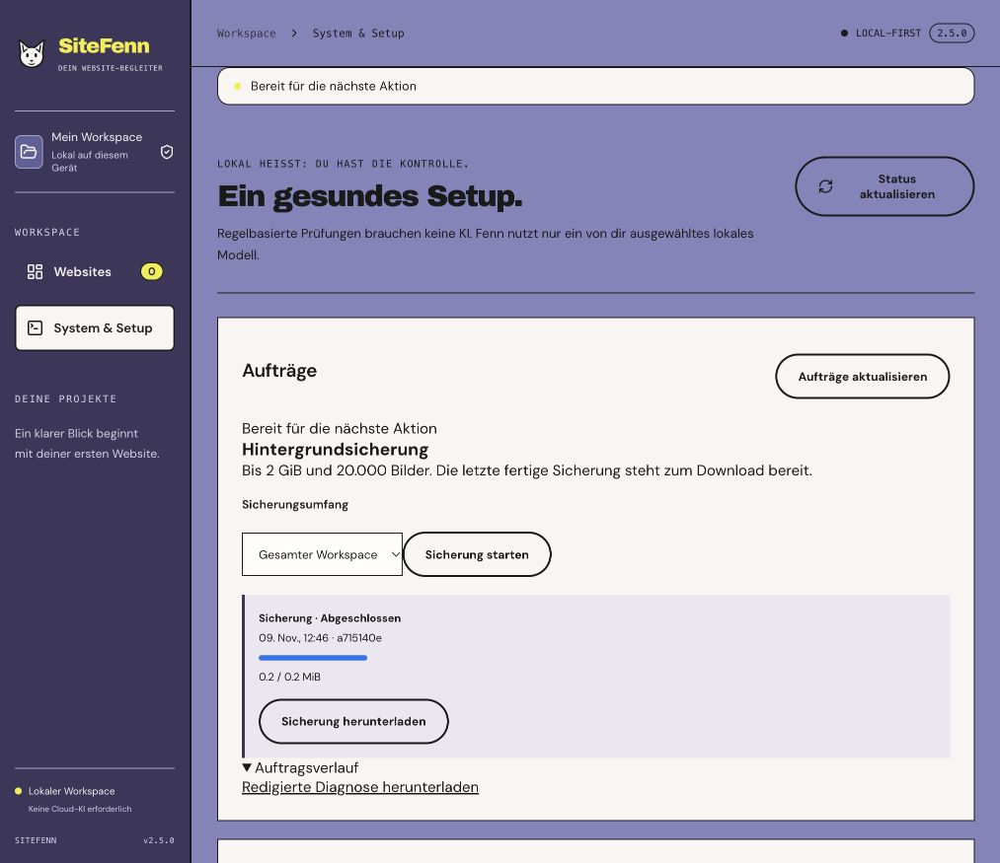

# SiteFenn 2.5 · Local jobs and larger backups

Local Web/CLI release, 9 November 2026. [Roadmap](../PLAN-3.0.md).

## Jobs in System & Setup

The **Aufträge** panel shows work in progress, resource waits and recent outcomes across browser checks, local AI, exports, backups and maintenance. Browser checks and supported AI and backup jobs can be cancelled. Jobs with an available project or result link back to it. Browser reports may become available while the worker is still cleaning up. Controls use the shared readiness state and enable the next operation when resources are free.

The job history retains up to 150 terminal records. It survives a restart. SiteFenn reconciles saved browser results with interrupted job records at startup. Interrupted backup or AI jobs can be started again by the user. The redacted JSON diagnostic export contains job IDs, phase, timestamps, versions and standard error codes. It excludes audited URLs, report content, prompts, filesystem paths and raw error messages.

The screenshot shows a real backup in an isolated empty workspace. The large-backup check used a separate fixture.

## Backup and recovery

Choose the entire workspace or one project. The separate backup worker streams a SQLite snapshot and evidence into a `.sitefenn` file, with a 2 GiB source-data cap and a 20,000-image cap. The artifact becomes available after successful completion. Only the latest completed artifact is kept for download. A project backup contains the selected project and its linked evidence and clears workspace-wide settings. The legacy ZIP download and the existing pre-update ZIP remain available under their original limits.

Restore either format with `npm run restore -- /absolute/path/backup.sitefenn /absolute/path/NEW-workspace`. The streaming format verifies SHA-256 per entry and across the archive, then checks the restored SQLite database. Schedule definitions are restored disabled and require fresh acknowledgment. Runtime job records are cleared during restore. The archive contains local data and can contain sensitive evidence. SHA-256 checks integrity and provides no encryption. The database remains on additive schema 3.

## Schedules

Choose **Skip** or **Catch up once** for downtime. While the application is running, a due job waiting on resources stays pending as one occurrence. There is no operating-system service. The app uses a 30-second scheduler heartbeat to distinguish a long runtime gap from ordinary resource waiting.

## Verification

- 166 Node tests and 37 browser tests passed locally, alongside TypeScript and the production build.
- Restart reconciliation, backup cancellation, redacted diagnostics, scoped restore, checksum rejection and disabled restored schedules have automated coverage.
- A virtual 24-hour scheduler test exercised 2,880 ticks, resource waiting and the single catch-up policy. A real 24-hour endurance run is pending.
- `npm run test:large-backup` wrote and restored 2,001 synthetic evidence files, including one 260 MiB file, then verified the restored SQLite data and evidence. On macOS with Node 24.19.0 the archive was 272,956,456 bytes. The smoke process peaked at 97.5 MiB RSS against a 192 MiB test budget. One local run took 360 ms to write and 368 ms to restore. The fixture uses synthetic bytes and the timings are specific to this run.
- A real 32 MiB isolated macOS test volume produced `disk-full` in the backup worker. A retry completed after freeing space.
- Independent pilots, a real Google Search Console authorization, Windows acceptance and signed native packages remain open.

[GitHub Actions checks](https://github.com/mxweir/sitefenn/actions/workflows/ci.yml).
