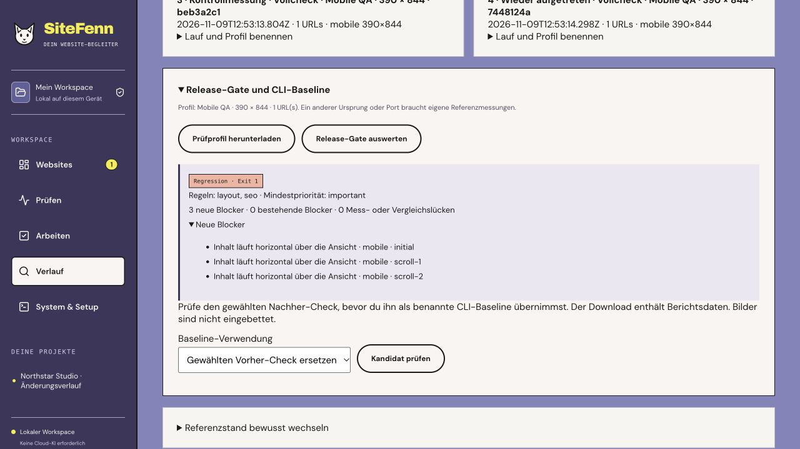
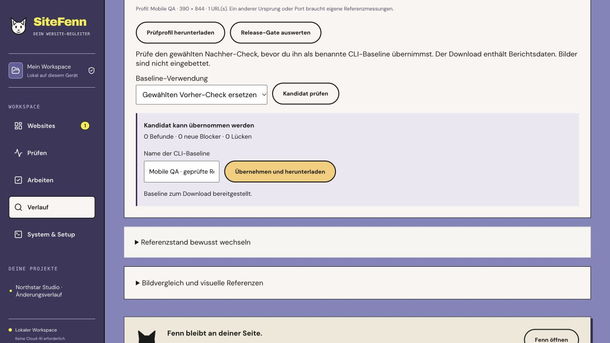

# SiteFenn 2.6 · A release gate for preview builds

Local Web/CLI release, 9 November 2026. [Roadmap](../PLAN-3.0.md).

## In the project

Name your check and its profile under **Verlauf → Vergleich → Lauf und Profil benennen**. Open **Release-Gate und CLI-Baseline** to evaluate the selected pair. The panel separates new measured blockers, existing blockers and measurement or comparison gaps. The selected after-check's saved policy governs the result. Older checks use the default critical-only policy.

Download the profile and import it again from **Übersicht → Gespeichertes CLI-Prüfprofil verwenden**. SiteFenn previews the scope and asks you to confirm the pages and any stored browser actions. The profile must match the project ID, environment and URL. Use a separate project/profile and reference for another staging host or local port. The same hostname with a different port is a different origin.

From the comparison panel, review a first CLI baseline or a replacement against the selected earlier check. Explicitly name and approve an eligible candidate to download it. That download is a portable reference for the CLI. The application's visual reference history is a separate control.





## In the CLI and CI

Use the exact same SiteFenn revision, environment, Chromium and measurement contract when establishing the reference and running the gate. On the first run, exit 2 means there is no comparison baseline yet. Review the candidate's local report before copying its displayed SHA-256 into the approval command.

```sh
npm run audit:check -- --profile profile.json --out first-run --authorized
npm run audit:check -- baseline-review --profile profile.json --candidate first-run/report.json
npm run audit:check -- baseline-adopt --profile profile.json --candidate first-run/report.json --name "Preview baseline" --confirm REVIEWED_SHA256 --out baseline.json
npm run audit:check -- --profile profile.json --baseline baseline.json --out next-run --authorized
```

For a replacement, supply `--baseline baseline.json` in both review and adoption and write a new file. A compatible candidate with no new blockers or measurement gaps can be promoted. Adoption records the previous report's checksum and refuses to overwrite a file. A planned change to the measurement contract requires a newly reviewed first baseline. Legacy raw reports remain readable for existing integrations.

Exit **0** means no new measured blockers within the selected compatible policy. Exit **1** means a measured regression. Exit **2** covers gaps, incompatible scope or execution errors. `gate.json` contains detailed local results and `summary.md` contains only counts and status for CI. `report.json` and baseline files can contain private report data. The CLI's optional `--source-repo` records a verified Git revision if the tracked checkout is clean before and after the check. This verifies checkout identity. It does not establish that a server is running a build from that revision or map a URL to a source line.

### GitHub Actions setup

1. Adapt the preview command and fixed loopback URL in the [workflow template](../examples/sitefenn-check.yml). Configure `SITEFENN_TOOL_SHA` as the full reviewed SiteFenn release commit. The app checkout and tool checkout are separate.
2. On a trusted matching Linux/Chromium environment, start the reviewed base version on that exact URL. Run the candidate and approval commands above. Provide `sitefenn/profile.json` and `sitefenn/baseline.json` from the reviewed base branch. Commit only material you are authorized to store in that repository. For private reports, use your approved private workflow and storage. The example assumes the reviewed inputs can be stored in the target repo.
3. Make the workflow a required check once your preview and baseline are ready. Review replacement baselines as explicit changes to the base-branch inputs.

The template runs preview code from trusted branches with a read-only token and no persisted checkout credentials. It shares one runner with the preview, so only use it where you trust that code. It adds only the compact summary to the workflow run and contains no artifact upload. SARIF and source annotations are omitted because the gate cannot prove source-line mapping.

## Developer handoff and verification

Selected work packages carry the measured viewport dimensions where available, rule and location, scope restrictions and a reproducible acceptance step. Screenshots stay as references. Optional literal source matches require explicit selection and stay marked unconfirmed.

The isolated Git fixture served real commits from a test repository. A clean reference passed, a committed layout regression failed, existing baseline debt remained visible, a committed correction passed, and an unavailable preview returned inconclusive. The same test exercises reviewed adoption and replacement, digest tampering, changed port rejection and sanitized summaries. The project API smoke uses real browser measurements and checks the named profile and baseline workflow. The screenshots show that fixture in the running application.

166 Node tests, 38 browser tests, TypeScript, the production build and the portable Web/CLI smoke were run. GitHub Actions for the release commit covers macOS and Ubuntu. The example workflow was evaluated through the isolated fixture and release CI. Deployment as a required check in an external repository, live Google authorization, real Windows acceptance and signed native packages remain open.
