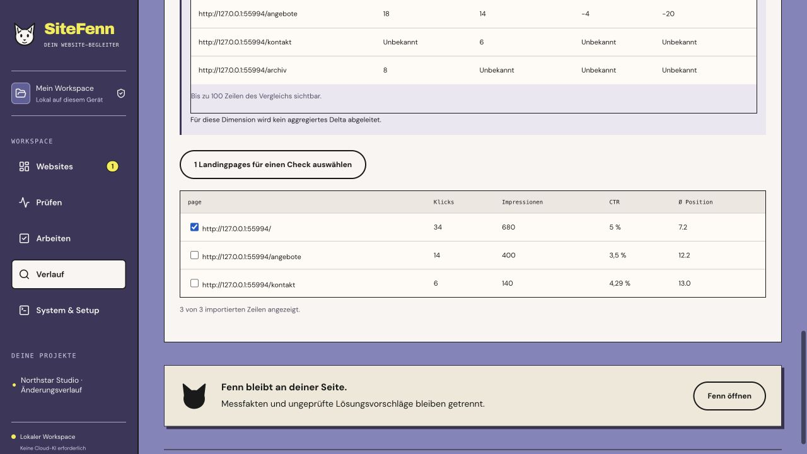
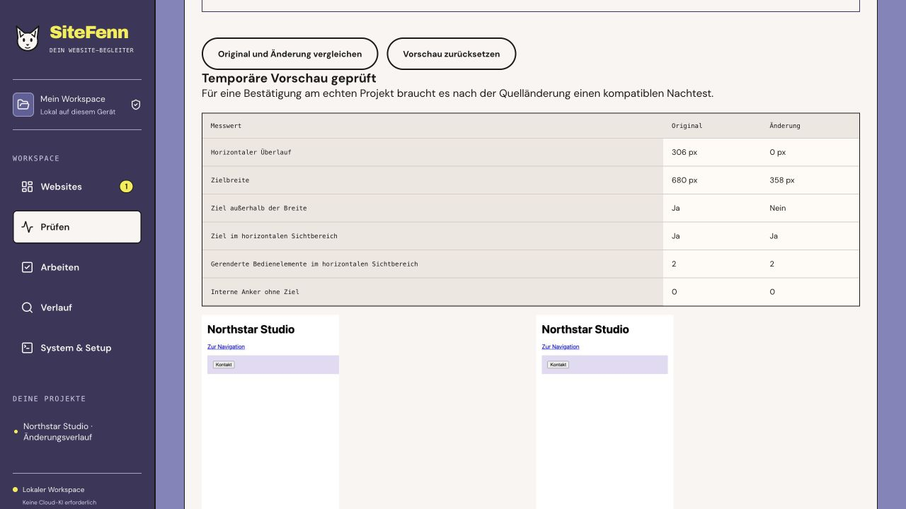

# SiteFenn 2.7 · Search visibility and the Fix Lab

Local Web/CLI release, 9 November 2026. [Roadmap](../PLAN-3.0.md).

## From visibility data to a check

Open **Verlauf → Sichtbarkeit** and choose CSV or Google Search Console. Select the property, inclusive period, dimension and country/device filters. CSV can explicitly mark filters as unknown. Google properties are listed after authorization. Its optional macOS connector uses a read-only Desktop OAuth client, with separate client ID and secret fields and Keychain storage. It distinguishes an expired or revoked grant from a quota failure.

Inspect the preview's scope, counts, sample rows and limitations before saving it. A preview is local, project-bound, single-use and valid for five minutes. Imported data records its source, filters, period and import time. Google imports carry the final-data setting and bounded Top Rows coverage. CSV carries export coverage and can have an unknown data state. These records describe the imported slice.

For page-dimension comparisons, choose an earlier non-overlapping period of equal length with matching source, property, dimensions, filters and data state. Click and impression deltas use URLs present in both datasets. A missing URL remains unknown. The API returns up to 500 comparison rows and the current screen shows the first 100. Select eligible same-origin landingpages to fill a check draft. The ordinary check controls provide the final start action.

Search Console's API can return a subset of top rows. Imported metrics and historical positions are independent of the Audit-Score. [Search Analytics API](https://developers.google.com/webmaster-tools/v1/searchanalytics/query).

The live connector remains experimental. The local protocol test exercised consent, refresh, expired grants, quota responses and confirmed/failed revocation with simulated Google responses. An authorized end-to-end Google account test remains pending. CSV works independently. CrUX remains outside this release. [Google OAuth refresh errors](https://developers.google.com/identity/protocols/oauth2/web-server#errors).

## Fix Lab · experimental

Open **Prüfen → Befunde → Fix-Labor**. Load the built-in example or paste up to 24 KiB of a local HTML fragment. Choose a single ID or class and a device profile. Try an allowlisted width, sizing or text-wrapping change, or rename the selected ID/class. The experiment compares actual Chromium screenshots, horizontal overflow, target geometry, rendered controls and unresolved internal anchors.

SiteFenn strips unsupported markup, uses a fresh Chromium context with page scripts disabled, rejects network requests and applies a restrictive Content Security Policy. The fragment and results live in the current session. Reset removes the UI result. The app stores no experiment in the project report or task history. Script-driven states, external assets, and full keyboard and accessibility behavior lie outside the experiment. A source change needs a fresh compatible check for verification.

## Verification

- 168 Node tests, 38 browser tests, TypeScript, production build and portable Web/CLI checks.
- Real Chromium isolated fixture for effective width, ineffective minimum width, changed ID/internal anchor and changed class/control visibility. The local network sentinel received zero requests.
- Actual Fastify/SQLite tests for unsaved preview, project isolation, stale preview and single-use confirmation. Matching imports produced a per-page delta. Missing rows remained unknown and changed country filters made the pair incompatible.
- The running application rendered two synthetic CSV imports and moved the selected non-homepage into an unstarted check draft. The Fix Lab screenshot shows an actual measured comparison in that application.
- Independent user pilots, a real Google account test, real Windows acceptance and signed native packages remain open.

[GitHub Actions](https://github.com/mxweir/sitefenn/actions/workflows/ci.yml).
