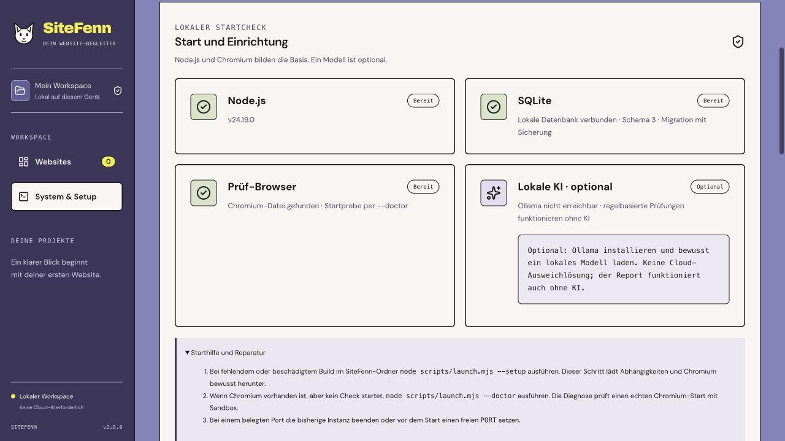
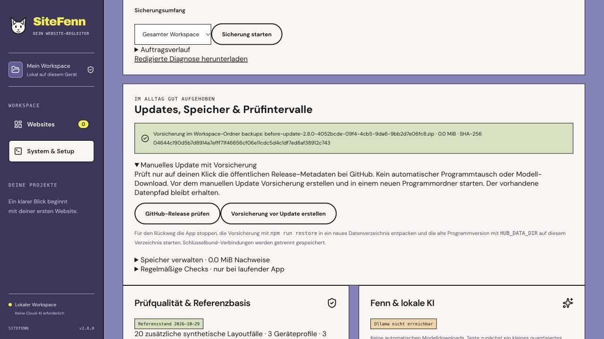

# SiteFenn 2.8 · Reliable local startup and recovery

Local Web/CLI release, 9 November 2026. [Roadmap](../PLAN-3.0.md).

## Start and diagnose

```sh
# First installation or repair. This explicitly downloads dependencies and Chromium.
node scripts/launch.mjs --setup

# Normal start.
node scripts/launch.mjs

# Diagnose the local installation without a download or workspace startup.
node scripts/launch.mjs --doctor
```

Node.js 24 is required. The launcher checks the compiled version and frontend entry assets. Before opening the browser, it waits for the child process it launched to confirm its PID, app version and loopback address over IPC. The child sends that confirmation after binding the port. An unrelated web service cannot provide it. Port conflicts show the port and stop the launcher. Use `PORT` to choose another loopback port. The default startup deadline is 25 seconds. The optional `SITEFENN_START_TIMEOUT_MS` setting accepts 250–120,000 ms. The deadline applies to server startup after setup. The launcher forwards termination and the service shuts down if the launcher's IPC channel closes.

**System & Setup → Start und Einrichtung** brings runtime, database, browser and optional model status together. `--doctor` starts sandboxed Chromium to test the installation. The app's status panel indicates whether the Chromium file is present and links that check to the real start probe. Ollama runs independently, and any local model is selected separately.



## Upgrade and return to the previous release

1. In the old version, create a verified pre-update backup under **System & Setup → Manuelles Update mit Vorsicherung**. Keep the old program folder and its backup.
2. Verify the new release's SHA-256 and extract it into a new program folder. Stop the old process. Start the new version with the same workspace path. Use `--setup` if the new folder needs its dependencies installed.
3. To return to the previous version, stop the new service. Restore the saved archive into a new data directory and start the old version with `HUB_DATA_DIR` pointing there.

```sh
npm run restore -- /absolute/path/before-update.zip /absolute/path/restored-workspace
# From the old program folder
HUB_DATA_DIR=/absolute/path/restored-workspace node scripts/launch.mjs
```

The restored workspace represents the backup date. Work created after that backup stays in the original workspace. The optional Keychain connection is stored separately. The release uses schema 3 and the existing portable backup formats.



## Verification

- 168 Node tests, 39 browser tests, TypeScript and production build.
- An extracted 2.8 package was tested against the actual published 2.7 ZIP pinned by SHA-256. The old build created a project and a complete browser report. Upgrade preserved the report and the evidence image byte for byte. The rollback opened the restored workspace using the 2.7 server and verified the same report and image.
- Package checks exercised explicit setup, the sandboxed browser diagnostic, a foreign HTTP 200 on the selected port, incompatible builds and handshakes, a stalled child, abrupt launcher loss, corrupt SQLite startup and refusal of a damaged backup. The original upgraded workspace was opened again after rollback verification.
- macOS and Ubuntu are checked by release CI. The Windows convenience script remains experimental pending a real Windows acceptance run.

## Desktop feasibility

A macOS-only, headless Swift supervisor was built and measured as a candidate wrapper for the existing React/Node core. Five runs per option used the same initialized workspace on Apple M5 Pro, macOS 26.6.2 and Node 24.19.0. The stopwatch ended at the launcher's IPC-backed ready line. RSS is the sum of resident memory across the process tree and can count shared pages more than once.

| Measurement | Web/CLI launcher | Swift supervisor + same launcher |
| --- | ---: | ---: |
| Median time to ready | 393 ms | 396 ms |
| Median summed RSS | 306.3 MiB | 312.3 MiB |
| Additional wrapper footprint | — | 63,176 bytes binary / 9,918 bytes compressed |

All 11 launches including warm-up shut down cleanly. The Web/CLI ZIP measured about 7.7 MiB in this run. The compressed wrapper figure estimates only the wrapper's addition to a full download. A native installer, bundled runtime, graphical shell, delta update, signing and notarization were outside this prototype. Reproduce after packaging with `node scripts/benchmark-desktop.mjs` on macOS with Swift.

The Web/CLI launcher remains the distribution for 2.8. The measured wrapper adds supervision overhead and still requires the same runtime. A future graphical desktop package needs its own install/update and platform acceptance. Independent pilots, real Google authorization and signed native packages remain open.

[GitHub Actions](https://github.com/mxweir/sitefenn/actions/workflows/ci.yml).
