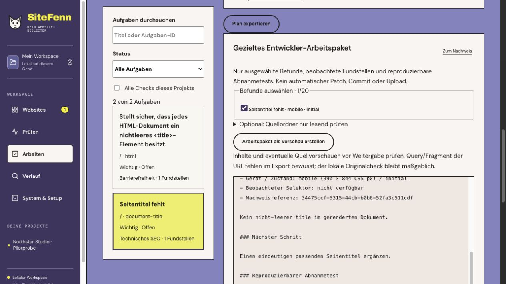
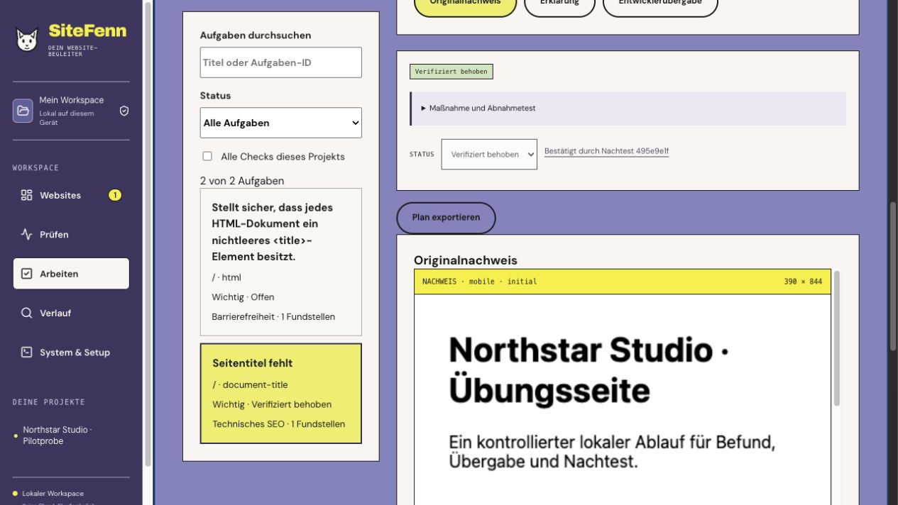

# SiteFenn 2.9.0-rc.1 · Pilot release candidate

This release candidate is for a small independent pilot. The stable distribution remains 2.8.0. [Pilot protocol and session record](PILOT-2.9.md).

## Changes from the internal rehearsal

- The Markdown previews can receive keyboard focus. The dialog focus loop uses available controls and restores the prior focus on close.
- Returning from the inline developer handoff restores focus to the original evidence control.
- A verified repair gets its own status and links directly to the saved confirming check. Manual review has a separate control.
- The stable update check recognizes a stable release with the same version core as newer than its release candidate.

## Evidence and open acceptance

| Check | Status |
| --- | --- |
| Internal keyboard rehearsal | Passed on one owned synthetic project with actual Chromium measurements. Opened the measured finding, exported a scoped Markdown package, preserved the finding on an unchanged retest, edited the HTML source, verified the correction, reloaded and followed the saved confirming check. |
| Browser zoom | Native Safari displayed 200% on macOS and opened the developer handoff at that zoom. Existing Chromium reflow checks cover reduced CSS viewport widths separately. |
| VoiceOver | VoiceOver was activated on macOS with Safari on the pilot project. Native input control interrupted the navigation before a complete task sequence could be confirmed. The full VoiceOver run remains open. |
| Independent participants | 0 of at least 5 completed. |
| Independently authorized projects | 0 of 5–8 included. |
| External pilot false alarms and false verifications | Pending. The single unchanged internal fixture remained unverified. |
| Stable pilot gate | Open. The external thresholds and complete accessibility run must be evaluated before a stable decision. |

168 Node tests and 40 browser tests, TypeScript, production build and packaged upgrade/recovery checks were run. The package test uses the published 2.8.0 archive pinned by checksum. The release provides a local fixture and a protocol for independent runs. External project permission and participant consent must be arranged separately.

[Apple VoiceOver commands used for the native probe](https://support.apple.com/guide/voiceover/general-commands-cpvokys01/mac).
