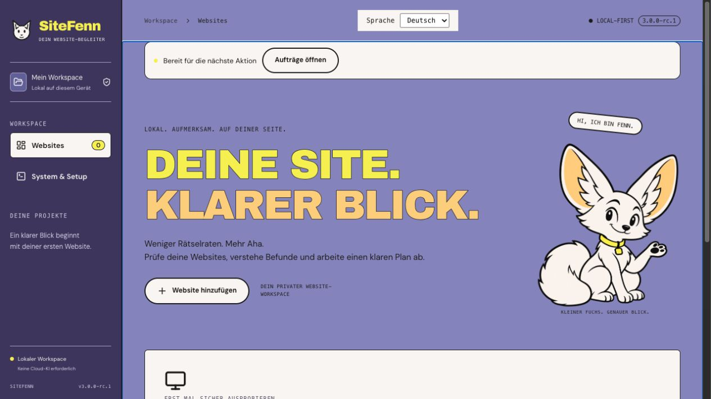
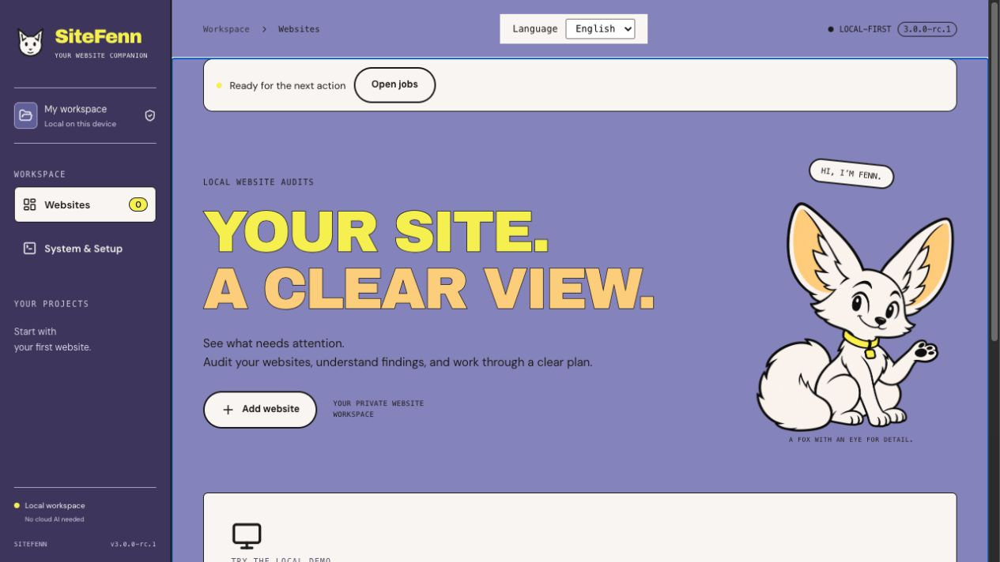

# SiteFenn 3.0.0-rc.1

This Web/CLI release candidate adds German and English to the core interface and verifies migration from the published 2.0.0 package. The stable release remains 2.8.0.

Use the language selector in the top bar. The choice is saved in the browser and sets the page language for assistive technology. The core screens have bilingual navigation, project setup, check controls, reports, repair tasks, history and setup headings. Some advanced controls, messages and report content still use German. Saved observations, Markdown exports and audit rules retain their original language.

## Verification

The portable test creates a report in the published 2.0.0 build, upgrades its real schema-2 workspace to schema 3, and checks that the original report and screenshot checksum match. A migration backup is created. The same test checks a fresh install, rejected startup conditions, upgrade from 2.8.0, and a rollback from a verified backup into a separate workspace. Both older packages are pinned by SHA-256.

168 Node tests and 41 browser tests cover the core workflow and language switch. The repair rehearsal runs with real Chromium and no model. A retest before changing the source leaves the finding unverified. The corrected retest confirms the repair and stays linked after reload. Regression tests also cover reference protection, recovery, invalid measurement contracts and handling incomplete AI results.

| Local measurement on Apple M5 Pro | 2.0 baseline | 3.0 RC |
| --- | ---: | ---: |
| Browser audit, 20 synthetic pages across three viewports | 13.99 s | 14.07 s |
| Peak sampled process-tree RSS during the audit | 656 MiB | 660 MiB |
| 95th percentile frame capture to worker IPC | 80 ms | 80 ms |

Both audit runs used the same synthetic labels and browser version. They produced the same outcomes for the two measured rules. This is a single-run regression comparison with model and Lighthouse disabled. [2.0 measurement record](evaluation/benchmark-2.0.json) · [3.0 measurement record](evaluation/benchmark-3.0-rc1.json).

Separate one-off measurements on the same machine:

- **Lighthouse:** One desktop and one mobile sample against the local demo. Combined check and lab time 12.44 s, peak Node worker RSS 652 MiB. The memory figure excludes child processes.
- **Local model:** One direct Ollama request with an installed Qwen 2.5 3B model took 1.37 s including loading and generated 31 tokens. Ollama reported about 2.02 GiB for the loaded model. This measures one prompt, not the full SiteFenn AI workflow or answer quality.
- **Backup:** The streamed 260 MiB fixture with 2,001 files took 1.85 s to write and 1.30 s to restore, with peak worker RSS at 73 MiB. These figures use different workloads from the audit table.

## Open release criteria

The external pilot with at least five independent participants and five to eight authorized projects, a complete VoiceOver run, and the proposed 100-case held-out evaluation remain open. The local synthetic dataset measures regression on known fixtures. [Pilot protocol](PILOT-2.9.md).

Google access, generative advice and Fix Lab remain experimental. A live Google account test, independent AI quality review, native signing and real Windows acceptance remain open. The RC is distributed as a local Web/CLI package.
